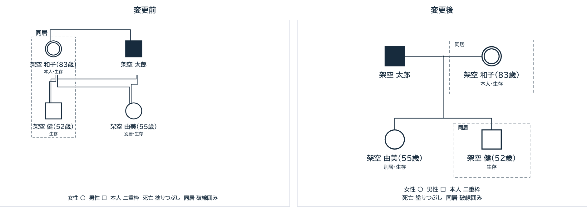
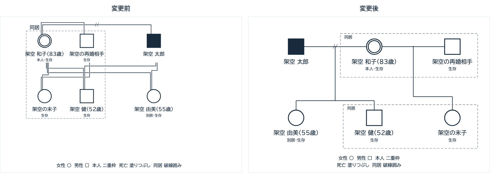

# Issue #249 家族構成図の関係線

2026-11-24。架空データのみで検証。元の実装はmain `2c0db0f`。画面の関係線を再現したテストが「夫婦線に上方迂回がない」の条件で失敗することを確認してから修正した。

## 比較

左が修正前、右が修正後。旧SVGを同じ架空データから生成して固定し、Playwright/Chromiumの実ブラウザで並べて撮影した。元Issueの画像や実利用者のデータは画像・フィクスチャに転載していない。

### 4人家族

### 離婚・再婚と異なる親の集合

## 変更した規則

- 婚姻・離婚の登録を使って同世代のまとまりを作り、関係を優先して人物を配置する。同居・別居の属性で左右の別レーンへ離さない。
- 隣接する配偶者は記号の側面を水平につなぐ。離婚はその関係線上に記号を置く。同じ二人の婚姻と離婚の登録が併存するときは、線を重複させず離婚の登録を表示する。記録自体は残す。
- 各子の明示された親集合が完全一致するときだけ共通の兄弟線を使う。両親の婚姻・離婚線が使える場合は、その中点から幹線を出す。
- 片親や婚姻未登録の両親は、記号と名前を避けた親子線を使う。配偶者から親子関係を補完しない。片方だけ親が分かる子を両親共通の兄弟線に入れない。
- 世代をまたぐ関係や隣接できない配偶関係は外側の経路へ回す。異なる家族線の交差は白い橋で分け、共有の夫婦線中点は接点で示す。
- 同居は段ごとの連続した該当者だけを破線で囲む。複数の囲みは別世帯の推定ではなく、各人物の「同居」属性の表示。同居未確認・別居・死亡者を混ぜない。既存の生死判定処理は変更しない。
- 名前は12文字ごとに折り返し、状態ラベルを含む境界から人物間隔・世代間隔・同居枠の余白を決める。凡例を2行にして余分な横幅を減らす。
- 人物・関係のIDで安定した順序を作る。入力配列の順序や保存されていた座標を変更しない。
- 編集・プレビュー・PDFは同じ `diagramSvg` を使う。家族図のPDF用画像だけ12px/mm（約305dpi）へ上げ、アセスメントの小さい図欄で氏名と線がぼやけないようにする。他の図の解像度は変更しない。

`Doc.family.people / relations`、diagramSchema、revision、チャット提案・確認・反映のAPIに変更なし。新しいOSSやAIの呼び出しも追加しない。

## 検証

- `npm run typecheck` 成功。
- `DATABASE_URL=<ローカル隔離DB> npm test`：552件成功、失敗・skipなし。
- `npm run build` 成功（既存のチャンクサイズ警告あり）。
- `test/diagram.test.ts` / `test/diagram-chat.test.ts`：37件成功。4人家族、片親、婚姻未登録、離婚再婚、3世代、親が片方だけ判明、世代をまたぐ登録、長いラベル、複数の配偶関係、婚姻未登録で異なる親集合を持つ子を検証。12人の兄弟の共有線も確認。
- 対象のrelation IDが過不足なく経路へ対応すること、子の親集合を補完しないこと、人物記号・氏名・状態ラベルを線が横断しないこと、同居枠に他の人物を巻き込まないこと、配列逆順でも同一SVGになること、保存データを変更しないことを検査。
- `e2e/family-layout.spec.ts` と既存の編集統合テスト：Chromium/PCとWebKit/iPad縦向き相当で4件成功。実際の人物選択、名前の編集、確認から用紙への反映、関係5件の維持を確認。iPad実機での検証ではない。
- `api/pdf.ts` の通常出力経路で、4人家族・再婚例・3世代の架空図を実アセスメント原紙に出力。PDFの3ページ目の家族図欄をPopplerで300dpiに描画し、関係線・氏名・年齢・同居枠・離婚記号に欠けや文字の貫通がないことを目視確認。PDFと原紙由来のページ画像は公開リポジトリに追加していない。
- PDF用家族図が80×60mmの指定に対して960×720pxになる回帰も検査。

再実行は `e2e/family-layout.spec.ts` と `test/fixtures/family-layout*.ts(x)` を使用。通常の `npm test` ではブラウザや実AIを呼ばない。

## 残る制約

自動配置は最小交差数を数学的に保証するものではない。多数の配偶関係や世代をまたぐ関係では外側の経路や交差の橋が必要になる。人物数の非常に多い図は広がるため、アセスメントの固定サイズの図欄では文字が小さくなる。紙の大きさ・データの分割は変更していない。男女や年齢から未登録の関係・出生順・生死・同居を推測しない。
