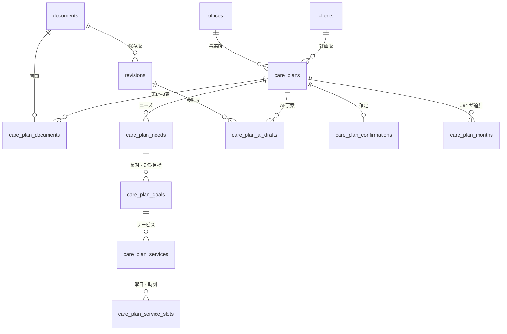

# ケアプラン仕様（第1〜3表・計画版・第6/7表への参照）

状態: 下書き（2026-11-19）

対象: #90（第1〜3表・AI 原案・編集・版管理・PDF）。#94（第6表）と #96（第7表）が参照する契約もここで決める。

前提は [再設計/13_DB設計.md](再設計/13_DB設計.md)・[再設計/14_認可.md](再設計/14_認可.md)・[再設計/16_書類と点検の基盤.md](再設計/16_書類と点検の基盤.md)。値は書類ごとに持ち（`field_values.document_id NOT NULL`）、書類を作るときに同じ key を一度だけ写す。写したあとに自動で同期しない。この仕様は、その決まりをケアプランでも変えない。

## 1. 制度上の様式と出典

| 様式 | 出典 | 適用・参照 |
|---|---|---|
| 居宅サービス計画書 第1表・第2表・第3表 | 厚生労働省「介護サービス計画書の様式及び課題分析標準項目の提示について」（平成11年11月12日 老企第29号、最終改正 令和6年7月4日 老認発0704第1号） | 令和7年4月1日から施行。PDF `https://www.mhlw.go.jp/content/001271371.pdf` の16〜18ページ（第1表・第2表・第3表）。2026-11-19 に確認 |
| 第6表・第7表 | 同じ通知の21〜22ページ | #94・#96 で使う。本仕様では参照キーだけを決める |
| 改正前の様式 | `https://www.mhlw.go.jp/content/000764680.pdf`（2021-04-01 作成） | 既存の書類の版を変えないための記録。新しい様式には使わない |

- 第1〜3表は、1つの計画版に対して3つの書類（`form_kinds` の `care_plan_1`・`care_plan_2`・`care_plan_3`）にする。1つの pdfme 様式に3表を詰めない。ページ・印字欄・事業所版の選択を、表ごとに独立して扱えるようにするため。
- 事業所の様式があればそれを使い、なければ全体の様式を使う（#103/#112 の決まり）。計画版を作ったあとに様式を公開しても、その計画版の書類の `template_version_id` は変えない。
- 第1〜3表の全体様式は `forms/seed/care_plan_1`・`care_plan_2`・`care_plan_3` に置く。元の PDF と座標データは公開リポジトリに入れない（既存の様式と同じ）。

## 2. 全体の関係



- 利用者（`clients`）1人に、計画版（`care_plans`）を何版でも持てる。
- 計画版は、第1表・第2表・第3表の3書類を1つずつ持つ（`care_plan_documents`）。
- 第2表のニーズ・目標・サービスは計画版の表（`care_plan_needs`・`care_plan_goals`・`care_plan_services`）に持つ。第3表の曜日・時刻は `care_plan_service_slots` に持つ。どれも安定した UUID を持つ。
- 第1表の文章は、これまでどおり `field_values` に `plan.*` の key で持つ。第2表・第3表の書類には、保存・確定のときに同じ内容を pdfme 用に射影する（「5. 値の持ち方」）。
- #94 の月次データは `care_plan_months` 以降に持ち、計画版と確定スナップショットを参照する。月次データを `documents` の1行に押し込まない。

## 3. 計画版（`care_plans`）

| 列 | 型 | NULL | 説明 |
|---|---|---|---|
| `id` | uuid | × | 計画版の ID。API の `planId` |
| `office_id` | uuid | × | 事業所。リクエストの値は使わず、職員の `office_id` で必ず絞る |
| `client_id` | uuid | × | 利用者 |
| `plan_series_id` | uuid | × | 同じ計画の版をまとめる ID。最初の版を作るときに生成し、改定版も同じ値にする |
| `version` | integer | × | 同じ `plan_series_id` の中の版番号（1から） |
| `status` | text | × | `draft`（編集中）・`confirmed`（確定）・`superseded`（新しい版に置き換えられた） |
| `effective_from` | date | × | 計画の適用開始日 |
| `effective_to` | date | ○ | 適用終了日。空は終了日なし |
| `previous_plan_id` | uuid | ○ | 改定前の計画版。最初の版は空 |
| `created_by` | uuid | ○ | 作った職員 |
| `created_at`・`updated_at` | timestamptz | × | |
| `confirmed_at`・`confirmed_by` | timestamptz・uuid | ○ | 確定した時刻と職員。`status` が `confirmed`・`superseded` なら必須 |
| `lock_version` | integer | × | 楽観ロック用。計画版の構造を変えるたびに1増やす。既定は1 |

決まり:

- `(client_id, plan_series_id, version)` は一意。
- `effective_to` は `effective_from` 以降。
- 同じ利用者で `status='confirmed'` の計画版は1つだけ（部分一意索引）。新しい版を確定するときは、古い `confirmed` を同じトランザクションで `superseded` にする。
- 状態は `draft → confirmed → superseded` の順だけ。`confirmed` から `draft` に戻さない。訂正は新しい計画版を作る。
- `draft` の間だけ、計画版の行・第1〜3表の書類・ニーズ・目標・サービス・曜日時刻を変えられる。`confirmed`・`superseded` は読み取り専用。
- `draft` は削除できる。`confirmed`・`superseded` は履歴として削除しない。
- 別の事業所の `care_plans.id` は、API では「無い」として 404。DB の外部キーだけでは事業所を守れないので、API のリポジトリ層で必ず `office_id` を条件に入れる。

## 4. 第1〜3表の書類（`care_plan_documents`）

| 列 | 型 | NULL | 説明 |
|---|---|---|---|
| `plan_id` | uuid | × | → `care_plans(id)`。計画版を消すと一緒に消える |
| `form_no` | smallint | × | 1・2・3 |
| `document_id` | uuid | × | → `documents(id)`。1つの書類は1つの計画版だけに属する（一意） |

- 主キー `(plan_id, form_no)`。`form_no` は `1..3`。
- `document_id` の書類の `kind` は `care_plan_<form_no>`、`client_id`・`office_id` は計画版と同じでなければならない（DB トリガーで確かめる）。
- 計画版を作るときは、3つの書類を同じトランザクションで作り、3行を入れる。1つでも失敗したら計画版ごと残さない。
- 3つの書類の `seq` は、利用者・種類ごとに増える（`documents` の既存の決まり）。計画版の `version` とは別物。計画版が同じでも、書類を作り直したら `seq` は進む。
- 第1表の書類は `form_kinds.create_from='assessment'` により、作成時にアセスメントの同じ key の値を一度だけ写す。写したあとは独立し、アセスメントを直しても第1表は変わらない。第2表・第3表は `create_from` を使わず、計画版の構造から作る。

## 5. 値の持ち方（正本と射影）

### 5.1 第1表

- `plan.createdDate`・`plan.changedDate`・`plan.firstCreatedDate`・`plan.kind`・`plan.intentionAnalysis`・`plan.overallPolicy`・`plan.livingAssistanceReason` など、既存の `core/fields.json` の `plan.*` をそのまま使う。新しい欄の辞書を作らない。
- 値は第1表の `documents` の `field_values` にだけ持つ。ほかの書類と共有しない。
- 保存は既存の `POST /api/documents/:id/save` と `revisions` を使う。
- 事業所の様式だけの欄は、その版の `local_fields` と `local.*` の値を使う。`local.*` はほかの書類へ写さない。

### 5.2 第2表・第3表

- 正本は計画版の表（`care_plan_needs`・`care_plan_goals`・`care_plan_services`・`care_plan_service_slots`）。
- 第2表・第3表の `documents` には、**保存・確定のときにだけ**、pdfme の印字用に次の key を射影する。射影は人が直接編集しない。
  - 第2表: `plan.needs`（既存の入れ子の形）
  - 第3表: `plan.weekly`・`plan.nonWeeklyServices`（既存の形）
- 射影は、その書類の `field_values` と `revisions."values"` に書く。`revisions` は保存のたびのスナップショットなので、過去の PDF を再現できる。
- 射影には安定 ID を入れない（`core/fields.json` の型に `id` がないため）。安定 ID は確定スナップショット（`care_plan_confirmations.snapshot`）に残す。#94・#96 は確定スナップショットを読む。
- 第2表・第3表の `field_values` の `plan.needs`・`plan.weekly`・`plan.nonWeeklyServices` を、汎用の `PATCH /api/documents/:id/fields` で直接変えることはできない（409 `use_plan_api`）。計画版の API を使う。第1表は汎用の欄の直しを使ってよい。
- 第2表・第3表の書類も、`documents.template_version_id` と `revisions` は既存の仕組みをそのまま使う。計画版を確定したあとに様式を公開しても、書類の版は変えない。

### 5.3 既存の `plan.needs` との関係

既存の `core/fields.json` の `plan.needs` は、次の入れ子を表す。計画版の表は、この意味を変えずに正規化しただけである。

```
plan.needs[]                        1つのニーズ
  need                              生活全般の解決すべき課題（ニーズ）
  longGoal                          長期目標
  longGoalPeriod                    長期目標の期間（表示用）
  shortGoals[]                      短期目標
    goal                            短期目標
    period                          短期目標の期間（表示用）
    services[]                      援助内容
      content                       サービス内容
      insured                       ※1 保険給付の対象
      kind                          ※2 サービス種別
      provider                      ※2 サービス提供事業所
      frequency                     頻度
      period                        期間（表示用）
```

- 表の `period_text` が上の「期間（表示用）」、`period_from`・`period_to` が #94 の計算に使う適用期間。
- `care_plan_services.id` が #94 の stable service ID、`care_plan_service_slots.id` が stable slot ID。
- 表示用の文字と計算用の日付が食い違わないように、API は `period_text` を保存するときに `period_from`・`period_to` も受け取る。日付を省略した場合は計画版の適用期間を使う。

## 6. 第2表の構造と安定 ID

### 6.1 `care_plan_needs`

| 列 | 型 | NULL | 説明 |
|---|---|---|---|
| `id` | uuid | × | stable need ID |
| `plan_id` | uuid | × | → `care_plans(id)` |
| `ordinal` | integer | × | 表示順（1から）。並べ替えても `id` は変えない |
| `need_text` | text | × | ニーズ |
| `created_at`・`updated_at` | timestamptz | × | |

- `(plan_id, ordinal)` は一意（遅延可能）。並べ替えは同じトランザクションで行う。
- 計画版を消すと、ニーズ・目標・サービス・曜日時刻も消える。

### 6.2 `care_plan_goals`

| 列 | 型 | NULL | 説明 |
|---|---|---|---|
| `id` | uuid | × | stable goal ID |
| `plan_id` | uuid | × | → `care_plans(id)` |
| `need_id` | uuid | × | → `care_plan_needs(id)` |
| `level` | text | × | `long`（長期目標）・`short`（短期目標） |
| `ordinal` | integer | × | 同じニーズ・同じ level の中の表示順 |
| `goal_text` | text | × | 目標 |
| `period_text` | text | ○ | 表示用の期間 |
| `period_from`・`period_to` | date | ○ | 計算用の適用期間 |
| `created_at`・`updated_at` | timestamptz | × | |

- 1つのニーズに `long` は1つだけ（部分一意索引）。`short` は何個でもよい。
- `(need_id, level, ordinal)` は一意（遅延可能）。
- `need_id` と `plan_id` の組が `care_plan_needs` と一致することを複合外部キーで確かめる。
- 期間は `period_to >= period_from`。

### 6.3 `care_plan_services`

| 列 | 型 | NULL | 説明 |
|---|---|---|---|
| `id` | uuid | × | stable service ID（#94・#96 が使う） |
| `plan_id` | uuid | × | → `care_plans(id)` |
| `need_id` | uuid | × | → `care_plan_needs(id)` |
| `short_goal_id` | uuid | × | → `care_plan_goals(id)`（`level='short'`） |
| `goal_level` | text | × | 常に `short`。複合外部キーで短期目標だけを指すために持つ |
| `ordinal` | integer | × | 同じ短期目標の中の表示順 |
| `content` | text | × | サービス内容 |
| `insured` | boolean | × | ※1 保険給付の対象。既定は `true` |
| `service_kind` | text | ○ | サービス種別 |
| `provider` | text | ○ | サービス提供事業所 |
| `frequency_text` | text | ○ | 頻度（表示用） |
| `period_text` | text | ○ | 期間（表示用） |
| `period_from`・`period_to` | date | ○ | 計算用の適用期間 |
| `created_at`・`updated_at` | timestamptz | × | |

- `(short_goal_id, ordinal)` は一意（遅延可能）。サービスは短期目標の中で一意な順序を持つ。
- `(short_goal_id, need_id, goal_level)` の複合外部キーで、同じニーズの短期目標だけを指せる。
- サービスを削除すると、そのサービスの曜日時刻も消える。確定済みの計画版では削除できない。

### 6.4 並べ替えと削除

- API の入力は配列の順を `ordinal`（1以上）にする。並べ替えは、同じ計画版の行の `ordinal` を1トランザクションで付け直す（一意制約は遅延可能なので、途中で重なってもよい）。
- 既存の `id` を送らなかった行は削除、`id` を送った行は更新、`id` のない行は新規作成とする。
- ほかの計画版の `id` を送った場合は 422（`unknown_id`）。存在しない `id` も 422。
- サービスの削除は、そのサービスを参照する #94 の月次データがある場合、API は 409（`service_in_use`）を返す。月次データ側の外部キーは `ON DELETE RESTRICT` にする（#94 で追加）。

## 7. 第3表の曜日・時刻（`care_plan_service_slots`）

| 列 | 型 | NULL | 説明 |
|---|---|---|---|
| `id` | uuid | × | stable slot ID |
| `plan_id` | uuid | × | → `care_plans(id)` |
| `service_id` | uuid | × | → `care_plan_services(id)` |
| `schedule_type` | text | × | `weekly`（週単位）・`other`（週単位以外） |
| `weekday` | smallint | ○ | `weekly` のとき 1〜7（1=月、7=日、ISO-8601） |
| `start_time`・`end_time` | time | ○ | `weekly` のとき `HH:mm`。秒は使わない |
| `ends_next_day` | boolean | × | 終了が翌日か。既定は `false` |
| `note` | text | ○ | `other` のとき必須（例:「月2回」）。`weekly` でも補足に使える |
| `period_from`・`period_to` | date | ○ | この枠だけの適用期間。空ならサービスの期間、サービスも空なら計画版の期間 |
| `ordinal` | integer | × | 同じサービスの枠の中の表示順。既定は1 |
| `created_at`・`updated_at` | timestamptz | × | |

### 7.1 時刻の決まり

- `weekday` は 1=月曜〜7=日曜（ISO-8601）。日本時間（Asia/Tokyo、UTC+09:00）の壁時計として扱う。日本には夏時間がないので、UTC 変換で日付がずれることはない。
- `start`・`end` は `HH:mm` の24時間表記。`00:00`〜`23:59`。`24:00` は使わない。
- `schedule_type='weekly'` のとき:
  - `weekday`・`start`・`end` は必須。
  - `ends_next_day=false` なら `start < end`。`start == end` は 422。
  - `ends_next_day=true` なら `end < start`（終了が翌日）。`end >= start` は 422（24時間を超える枠は作らない）。
- `schedule_type='other'` のとき:
  - `weekday`・`start`・`end` は空、`ends_next_day=false`、`note` は空白でないこと。
  - 月次展開の対象外。第6表では「週単位以外のサービス」として別に表示する。
- 適用期間の優先順位は、枠（`period_from`・`period_to`）→ サービス（`period_from`・`period_to`）→ 計画版（`effective_from`・`effective_to`）。それぞれ、空の端は下の期間を使う。`period_to >= period_from`。
- 同じサービス・同じ曜日で、時間帯が重なる `weekly` 枠は 422（`overlap`）。接しているだけ（`end == start`）は重ならない。`ends_next_day` の枠は、翌日の `00:00` から `end` までを同じ曜日の時間軸に足して重なりを見る。異なるサービスどうしの重なりは許す（同時提供があるため）。
- まったく同じサービス・曜日・開始・終了・翌日フラグ・適用期間の枠は 422（`duplicate`）。

### 7.2 月次展開の読み取り契約（#94 用）

確定した計画版の `care_plan_confirmations.snapshot` は、次の形の `services` を持つ。

```json
{
  "schemaVersion": 1,
  "plan": {
    "id": "plan-uuid",
    "clientId": "client-uuid",
    "effectiveFrom": "2026-04-01",
    "effectiveTo": "2027-03-31"
  },
  "services": [
    {
      "serviceId": "service-uuid",
      "needId": "need-uuid",
      "shortGoalId": "goal-uuid",
      "content": "訪問介護",
      "serviceKind": "訪問介護",
      "provider": "見本事業所",
      "insured": true,
      "frequencyText": "週3回",
      "periodFrom": "2026-04-01",
      "periodTo": "2027-03-31",
      "weekly": [
        {
          "slotId": "slot-uuid",
          "weekday": 1,
          "start": "09:00",
          "end": "10:00",
          "endsNextDay": false,
          "periodFrom": "2026-04-01",
          "periodTo": "2027-03-31"
        }
      ],
      "other": [
        { "slotId": "slot-uuid", "note": "月2回", "periodFrom": null, "periodTo": null }
      ]
    }
  ]
}
```

- `targetMonth` は `YYYY-MM`。日付は Asia/Tokyo の暦日。
- 展開は、対象月の各日 `D` について、`D` が計画版・サービス・枠の適用期間すべての中にあり、`isoWeekday(D) == slot.weekday` の枠を1件の予定にする。`endsNextDay=true` の予定は開始日 `D` に属し、終了は翌日になる。月末をまたぐ終了も、開始日の月の予定として扱う。
- 同じ日に同じサービスが複数枠であれば、別々の予定（`slotId` ごと）にする。同日・同サービスの枠の重なりは 7.1 で禁止している。
- 祝日・休業日・事業所の休みは推測しない。#94 が明示的な例外として持つ。
- 過去の月を再現するときは、その月が参照した `confirmationId` のスナップショットを使う。現在の計画版の構造を読み直さない。
- 第3表の変更は、既存の第6表を自動で書き換えない。#94 の「再生成」は明示操作にする。

## 8. AI 原案（`care_plan_ai_drafts`）

### 8.1 記録する列

| 列 | 型 | NULL | 説明 |
|---|---|---|---|
| `id` | uuid | × | 原案の ID |
| `office_id`・`client_id`・`plan_id` | uuid | × | 事業所・利用者・計画版 |
| `source_document_id` | uuid | × | 参照したアセスメントの書類 |
| `source_revision_id` | bigint | × | 参照した保存版（`revisions.id`） |
| `source_revision_rev` | integer | × | その書類の中の版番号（`revisions.rev`） |
| `source_form_version_id` | uuid | × | 参照した保存版の様式の版 |
| `source_saved_at` | timestamptz | × | 参照した保存版の保存時刻 |
| `referenced_at` | timestamptz | × | 原案を作った時刻 |
| `status` | text | × | `proposed`・`applied`・`partially_applied`・`rejected`・`failed` |
| `model`・`prompt_version` | text | ○ | 使った AI と指示の版 |
| `proposal` | jsonb | × | 型付きの原案（第1表の候補、ニーズ・目標・サービス・曜日時刻の候補） |
| `conflicts` | jsonb | × | 根拠の矛盾・不明点。既定は空の配列 |
| `applied` | jsonb | × | 実際に入れた項目と、入れなかった理由。既定は空のオブジェクト |
| `error_kind` | text | ○ | `ai_failed`・`invalid_json`・`timeout` など |
| `created_by`・`applied_by` | uuid | ○ | 職員 |
| `applied_at`・`created_at` | timestamptz | ○・× | |

- `source_revision_id` は `revisions(id)` を指す。`source_document_id` と `source_form_version_id` がその保存版と一致することを DB トリガーで確かめる。
- `source_revision_rev` は `revisions.rev` と一致することを DB トリガーで確かめる。
- 参照元は同じ事業所・同じ利用者の保存済み `revisions` だけ。API は `office_id`・`client_id` を計画版から取り、リクエストの値を信用しない。
- 参照元のアセスメントが後で更新されても、この行の `source_revision_id`・`proposal` は変えない。再生成は新しい行を作る。

### 8.2 原案の適用

- 原案は未確定の下書きであり、保存・確定とは別。
- 適用できるのは `status='draft'` の計画版だけ。`confirmed`・`superseded` は 409。
- 第1表の欄は、**今の値が空**か、その欄が同じ原案から入った AI の値で、まだ人が直していないときだけ入れる。`field_values.by='cm'` の欄は上書きしない。
- 第2表のニーズ・目標・サービスと第3表の枠は、**新しい行の追加だけ**行う。既存の行の更新・削除はしない。同じ内容の行があれば追加しない。
- 適用しなかった項目は `applied.skipped[]` に理由（`human_value`・`existing`・`unknown_target` など）を残す。
- AI が失敗しても、計画版は手入力で最後まで作れる。`status='failed'` の行を残し、`error_kind` を返す。手入力の API は AI の成否に依存しない。

### 8.3 原案が決してしないこと

- 意向・サービス・頻度・費用・日時を、根拠なしに決めない。
- 人が直した値・確定済みの値を上書きしない。
- 参照元のアセスメントの変更を、計画版へ自動反映しない。
- `plan.confirmed` を AI が作らない。確定は人が明示的に行う。

## 9. 確定（`care_plan_confirmations`）

| 列 | 型 | NULL | 説明 |
|---|---|---|---|
| `id` | uuid | × | 確定スナップショットの ID。#94・#96 の `confirmationId` |
| `plan_id` | uuid | × | → `care_plans(id)`。1計画版に1つ（一意） |
| `document_1_id`・`document_1_revision_id` | uuid・bigint | × | 第1表の書類と、確定に使った保存版 |
| `document_2_id`・`document_2_revision_id` | uuid・bigint | × | 第2表 |
| `document_3_id`・`document_3_revision_id` | uuid・bigint | × | 第3表 |
| `snapshot` | jsonb | × | 確定時点の全体（第1表の値、ニーズ・目標・サービス・曜日時刻、stable ID） |
| `snapshot_sha256` | text | × | `snapshot` の正規化 JSON の SHA-256 |
| `confirmed_by` | uuid | × | 確定した職員 |
| `confirmed_at` | timestamptz | × | |

- 確定は、計画版の `status` を `confirmed` にし、同じ利用者の古い `confirmed` を `superseded` にし、この行を1つ作る。同じトランザクションで行う。
- 確定には、第1〜3表の3書類の**保存済みの版**が要る。未保存の変更があれば 409（`unsaved_changes`）。確定は現在の `field_values` ではなく、最新の `revisions` の値を使う。
- `snapshot` は、その時点の第1表の値と、stable ID 付きの第2表・第3表の構造を入れる。PDF の値と一致させる。
- `snapshot`・`snapshot_sha256`・`plan_id`・書類 ID・保存版 ID は書き換えない（DB トリガー）。確定の取り消しはできない。訂正は新しい計画版を作り、確定する。
- 確定済みの計画版は、`field_values` も構造も変えられない（DB トリガー）。人が直したいときは新しい計画版を作る。

## 10. API の契約

すべて職員の入口（`/api/...`）で、操作は `care.work`。1. 誰か（401）→ 2. どの事業所か（ほかの事業所は 404）→ 3. 操作を許すか（403）の順で確かめる。リクエストの `office_id` は使わない。

### 10.1 計画版を作る

`POST /api/clients/:clientId/care-plans`

```json
{
  "effectiveFrom": "2026-04-01",
  "effectiveTo": "2027-03-31",
  "copyFromPlanId": null
}
```

- 201 で `{ "plan": CarePlanView }`。
- 3つの書類を作り、第1表はアセスメントから同じ key を一度だけ写す。AI は使わない。
- `copyFromPlanId` があるときは、その計画版の構造を **新しい ID で** 写す（改定版）。`previous_plan_id` に元の計画版を入れる。元の計画版が別の利用者・別の事業所なら 404。
- 利用者が別の事業所・アーカイブ済みなら 404。`effectiveFrom` が不正なら 400。`effectiveTo < effectiveFrom` は 400。

### 10.2 計画版を読む

`GET /api/care-plans/:planId`

200 で `CarePlanView`。

```ts
interface CarePlanView {
  id: string
  clientId: string
  planSeriesId: string
  version: number
  status: 'draft' | 'confirmed' | 'superseded'
  effectiveFrom: string
  effectiveTo: string | null
  previousPlanId: string | null
  lockVersion: number
  documents: {
    formNo: 1 | 2 | 3
    documentId: string
    formVersionId: string
    latestRevision: number
    savedAt: string | null
  }[]
  plan1: Record<string, unknown>          // 第1表の保存値（revisions の最新）
  needs: NeedView[]                       // stable ID 付き
  slots: SlotView[]                       // stable ID 付き
  aiDraft: { id: string, status: string, referencedAt: string, sourceRevisionId: number } | null
  confirmation: { id: string, confirmedAt: string, confirmedBy: string, snapshotSha256: string } | null
}
```

- 別の事業所の計画版は 404。存在しない ID も 404。
- `GET /api/clients/:clientId/care-plans` は、その利用者の計画版を新しい順に返す（`id`・`version`・`status`・`effectiveFrom`・`effectiveTo`・`updatedAt`・`confirmedAt`）。

### 10.3 第2表の構造を保存する

`PUT /api/care-plans/:planId/needs`

```json
{
  "baseVersion": 3,
  "needs": [
    {
      "id": "need-uuid",
      "need": "一人で入浴ができない",
      "longGoal": { "id": "goal-uuid", "goal": "安全に入浴できる", "periodText": "2026年4月〜2027年3月", "periodFrom": "2026-04-01", "periodTo": "2027-03-31" },
      "shortGoals": [
        {
          "id": "goal-uuid",
          "goal": "手すりを使って浴槽をまたげる",
          "periodText": "2026年4月〜2026年9月",
          "services": [
            { "id": "service-uuid", "content": "入浴介助", "insured": true, "kind": "訪問介護", "provider": "見本事業所", "frequency": "週2回", "periodText": "2026年4月〜2027年3月" }
          ]
        }
      ]
    }
  ]
}
```

- 200 で `{ "plan": CarePlanView }`（生成した ID を含む）。
- `baseVersion` が現在の `lock_version` と違えば 409（`conflict`）。画面は読み直す。
- `id` のない行は新規、`id` のある行は更新、送られなかった既存の行は削除。
- 1つのニーズの `longGoal` は必須。`shortGoals` は0個以上。サービスは `shortGoals[].services` に置く。
- 422 の例: `unknown_id`・`long_goal_duplicate`・`period_order`・`service_goal_mismatch`。

### 10.4 第3表の曜日・時刻を保存する

`PUT /api/care-plans/:planId/schedule`

```json
{
  "baseVersion": 4,
  "slots": [
    { "id": "slot-uuid", "serviceId": "service-uuid", "scheduleType": "weekly", "weekday": 1, "start": "09:00", "end": "10:00", "endsNextDay": false },
    { "serviceId": "service-uuid", "scheduleType": "other", "note": "月2回" }
  ]
}
```

- 200 で `{ "plan": CarePlanView }`。
- `serviceId` は同じ計画版のサービスでなければ 422（`unknown_service`）。
- 7.1 の重なり・重複・時刻の決まりに反すれば 422（`overlap`・`duplicate`・`invalid_time`・`invalid_other`）。
- `baseVersion` が違えば 409。

### 10.5 保存する

`POST /api/care-plans/:planId/save`

```json
{ "baseVersion": 5 }
```

- 200 で `{ "plan": CarePlanView, "revisions": [{ "formNo": 1, "rev": 7 }, ...] }`。
- 第1表は現在の `field_values` を保存し、第2表・第3表は構造から射影して保存する。3書類の `revisions` を同じトランザクションで作る。
- 保存は計画版の `status='draft'` のときだけ。確定済みは 409。
- `baseVersion` が違えば 409。保存に失敗したら、3書類のどれも保存しない。

### 10.6 確定する

`POST /api/care-plans/:planId/confirm`

```json
{ "baseVersion": 6 }
```

- 200 で `{ "plan": CarePlanView, "confirmation": { "id": "...", "snapshotSha256": "...", "confirmedAt": "..." } }`。
- 3書類の最新 `revisions` が、現在の構造の射影と一致しなければ 409（`unsaved_changes`）。
- 古い `confirmed` を `superseded` にし、この計画版を `confirmed` にする。同じトランザクション。
- 確定済み・置き換え済みは 409。

### 10.7 AI 原案

`POST /api/care-plans/:planId/ai-drafts`

```json
{ "sourceDocumentId": "assessment-document-uuid", "sourceRevisionId": 12 }
```

- 201 で `{ "draft": AiDraftView }`。`status='proposed'` または `failed`。
- 参照元は同じ事業所・同じ利用者の保存済みアセスメント。見つからなければ 404。保存版でなければ 404。
- AI の出力が不正でも 201 で `failed` を返す（手入力は続けられる）。AI の失敗で計画版を壊さない。
- `POST /api/care-plans/:planId/ai-drafts/:draftId/apply` は `{ "baseVersion": 7, "acceptedProposalIds": ["..."] }`。200 で `{ "plan": CarePlanView, "applied": {...} }`。適用しなかった項目は `applied.skipped[]` に理由を残す。
- 原案の適用は 8.2 の決まりに従う。確定済みは 409。

### 10.8 PDF

`GET /api/care-plans/:planId/pdf?form=1|2|3`

- 200 で `application/pdf`。保存済みの最新 `revisions` と、その `template_version_id` から作る。画面の未保存値は出さない。
- 構造の射影が最新 `revisions` と違えば 409（`unsaved_changes`）。確定済みなら `care_plan_confirmations.snapshot` と `revisions` が一致することを確かめる。
- 元の PDF が置き場になければ 503（`form_unavailable`）。長文は黙って切り捨てず、pdfme の `dynamicFontSize` などで収まらない場合は 422（`overflow`）を返す。
- 3表を1つの PDF にまとめる場合は `form=all`。ページの順は第1表→第2表→第3表。

### 10.9 エラー

| 状態 | エラー | 意味 |
|---|---|---|
| 400 | `bad_request` | 本文の形・日付・時刻が不正 |
| 401 | `unauthorized` | ログインなし・停止した職員 |
| 403 | `forbidden` | 役割が `care.work` を持たない |
| 404 | `not_found` | 計画版・利用者・書類・保存版が無い。ほかの事業所もここに含める |
| 409 | `conflict` | `baseVersion` の不一致 |
| 409 | `unsaved_changes` | 保存していない変更がある |
| 409 | `not_draft` | 確定済み・置き換え済みを変えようとした |
| 409 | `use_plan_api` | 第2/3表の射影を汎用の欄の直しで変えようとした |
| 422 | `validation_failed` | 構造・時刻・期間の決まりに反する。`problems[]` に場所と理由 |
| 503 | `form_unavailable` | 様式の元の PDF が無い |

## 11. 認可と事業所の境界

- 計画版の作成・読む・構造の保存・AI 原案・確定・PDF は `care.work`（ケアマネまたは事業所責任者）。
- 未ログイン・停止した職員は 401、役割が違う場合は 403。
- ほかの事業所の `clientId`・`planId`・`documentId`・`sourceRevisionId` は 404。存在するかどうかを漏らさない。
- サイト管理者（`site.manage`）は `form_kinds` と全体様式の登録だけを行う。計画版・利用者の情報は読まない。
- 事業所の様式の登録は責任者の `form.manage`。ケアマネは様式を変えられない。
- 監査（`audit_events`）には、計画版の作成・保存・確定・AI 原案の適用・PDF 出力を残す。値そのものは入れない。

## 12. 手入力と AI なしの経路

- 計画版の作成、第1表の記入、第2表のニーズ・目標・サービス、第3表の曜日時刻、保存、確定、PDF は、AI を使わずにすべて実行できる。
- AI 原案は「空の計画版に候補を出す」任意の入口。AI が失敗しても、計画版の API は 200/201 を返し、手入力の経路を止めない。
- テストでは AI を偽物にし、失敗・不正 JSON・タイムアウトのときに計画版が壊れないことを確かめる。

## 13. #94・#96 との契約

### 13.1 #94（第6表）

- 月次データは `care_plan_months`（#94 で追加）に、`office_id`・`client_id`・`plan_id`・`confirmation_id`・`target_month`（`YYYY-MM-01`）を持つ。`(plan_id, target_month)` は一意。
- 月次データの各行は、確定スナップショットの `serviceId`・`slotId` を参照する。stable ID は計画版の中で不変で、改定版では新しい ID になる。過去月は `confirmationId` のスナップショットで再現する。
- 予定（plan）と実績（actual）は別の列・別の状態で持つ。実績未入力は 0 でも「未実施」でもない。
- 第3表の変更から月次データを自動で作り直さない。生成・再生成・前月コピーは明示操作。
- 予定・実績の集計は、`serviceId`・`slotId`・日付・状態を保った型付き API で #96 に渡す。集計で stable ID を落とさない。

### 13.2 #96（第7表）

- 第7表の計算は、保存済みの第6表の特定の版と、その元の `confirmationId` を入力にする。現在の第3表を読み直さない。
- サービスコード・単位数・地域区分・負担割合は #96 の算定マスタで決める。本仕様は stable service ID と適用期間だけを保証する。
- 未知のサービスコード・条件不足は「未計算・要確認」にし、0 円・0 単位や AI の推測で埋めない。

## 14. 受け入れテスト（PR1・PR2 で追加する Red テスト）

PR1 では、次の DB の決まりをテストにする。

1. `form_kinds` に `care_plan_1`・`care_plan_2`・`care_plan_3` があり、`per_client='many'`・`is_primary=false`・`create_from` は第1表だけ `assessment`。
2. 同じ利用者に計画版を2つ作ると、第1〜3表の書類・ニーズ・サービス・枠が混ざらない。計画版の `version` と `documents.seq` が別々に進む。
3. ニーズ・目標・サービスの `id` は、`ordinal` を並べ替えても変わらない。ニーズを消すと、そのニーズの目標・サービス・枠だけが消える。
4. 曜日・時刻の CHECK: `weekday` は 1〜7、`weekly` は `start < end`（翌日なら `end < start`）、`other` は時刻が空で `note` 必須。重複した枠は一意制約で落ちる。
5. AI 原案は、アセスメントの保存版 ID・版番号・様式の版・保存時刻を記録する。参照元のアセスメントを更新しても、原案の参照と `proposal` は変わらない。別の書類の保存版を指す原案は DB トリガーで落ちる。
6. 確定スナップショットは書き換え・削除できない。1計画版に1つだけ。確定済みの計画版の構造と第1表の値は変えられない。
7. `getCarePlan` は、ほかの事業所の計画版を 404（`NotFound`）にする。

API の 401・403・404、PDF、AI の失敗、UI は PR2〜PR4 でテストする。

PR2 では、`test/care-plan-api.test.ts` に次を追加した。

8. 計画版の作成・読み取りは事業所で絞られ、未ログインは 401、ほかの事業所は 404。第1表は作成時にアセスメントから写し、そのあとアセスメントを直しても変わらない。
9. 第2表は stable ID のまま並べ替えられ、古い `baseVersion` は 409、ほかの計画版の ID・期間の逆転は 422。
10. 保存は3表の `revisions` を一度に作り、第2表の射影を汎用の欄の直し・保存・印字欄の直しから守る（409 `use_plan_api`）。
11. AI 原案は保存済みアセスメントの版を固定し、人が直した値を上書きしない。AI の失敗・不正 JSON でも 201 で `failed` を返し、手入力を止めない。
12. 前の計画版からの改定版は、版番号と `plan_series_id` を引き継ぎ、第2表の stable ID は新しくする。

## 15. 未決（#94・#96 で決める）

- 第6表の月次行の具体的な列（予定・実績・キャンセル・再開・メモ）と、前月コピーの差分の持ち方。
- 第7表の算定マスタの版・適用開始日・サービスコードの持ち方。
- 確定済み計画版の訂正を、新しい計画版の作成だけで足りるか（運用レビューで確認する）。
- 事業所の様式が第1〜3表のどこまでを1つの PDF にまとめるか（表ごとに分けることを基本にする）。
