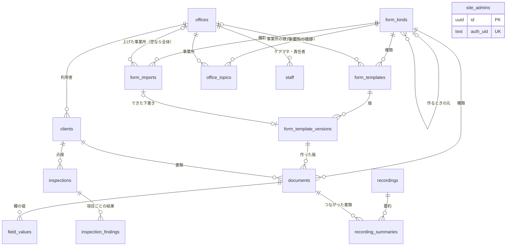

# DB 設計（書類の拡張、事業所での様式の登録、ユーザー種別の拡張、値の持ち方、点検）

状態: 下書き（2026-11-18。点検は 2026-11-20 に直した）

次の 6 つのためだけに、今の DB をどう変えるかを決める。ほかの目的では変えない。

| 目的 | 中身 |
|---|---|
| 書類の拡張 | 事業所ごとに形の違う書類を、どれも pdfme の様式として入れられる。アセスメントと入院時情報提供書のほかの種類も足せる |
| 事業所での様式の登録 | 事業所の責任者が、今使っている用紙の PDF を上げる。AI が様式の下書きにし、責任者が確かめて直し、公開すると、その事業所の様式になる。ケアマネは様式の違いを意識せずに書類を作れる |
| ユーザー種別の拡張 | ケアマネのほかに、事業所の責任者とサイト管理者を持てる。種類はあとで足せる |
| 値の持ち方 | どの値も、どれか 1 つの書類の値として持つ。基本情報（氏名・住所など 7 欄）を書類をまたいで 1 つに持つ仕組みはやめる。書類を作るときは、元にする種類の書類から同じ key の値を写す（今と同じ）。写したあとは同期しない（2026-11-18） |
| 点検 | AI によるケアプラン点検の 1 回分と、項目ごとの結果を持つ（2026-11-18。ケアマネの判断を持つのは 2026-11-20 にやめた） |
| 録音からの書き込み | 書類の種類ごとの「まとめる項目」、録音ごとの要約、事業所が直した項目を持つ（2026-11-19） |

土台は今の DB 設計（開発用リポジトリの `docs/DB設計.md` と `db/migrations/`）。ここには差分だけを書く。PDF から様式のデータをどう作るかは決めない（黒箱）。黒箱の入口は上げた PDF（`form_imports`）、出口は様式の版の下書き。黒箱が出したものは、「様式を公開する前の確かめ」を通れば正しい。この DB を使うコードの変え方（処理の流れ・API）は [16_書類と点検の基盤.md](16_書類と点検の基盤.md)。録音から AI が書く仕組みは [17_録音からの書き込み.md](17_録音からの書き込み.md)。そのための表もここに書く（「録音からの書き込み」）。

## 満たす条件

| # | 条件 | どこで満たすか |
|---|---|---|
| 1 | 書類の種類を足すときに、表の形を変えない（行を足すだけ） | `form_kinds`、`form_templates`、`documents` |
| 2 | どの様式も同じ形で入る（pdfme のテンプレートと、印字欄ごとの対応）。共通の意味（fields.json）にない、その様式だけの欄も持てる | `form_template_versions.local_fields`、その様式だけの欄の値、様式を公開する前の確かめ |
| 3 | 事業所は、種類ごとに自分の様式を持てる。なければ全体の様式を使う | 今のまま（引き継ぐ決まり） |
| 4 | 利用者 1 人に何通も作る種類（モニタリングなど）も持てる | `form_kinds.per_client`、`documents.seq` |
| 5 | 事業所に属する種類（ケアマネ、事業所の責任者）と、属さない種類（サイト管理者）を持てる | `site_admins`、`staff` |
| 6 | あとで種類を足しても、表を作り直さない | 種類の足し方 |
| 7 | 事業所の責任者が、自分の事業所の様式を登録できる（PDF を上げる → 変換の途中と失敗が見える → 下書きを確かめて直す → 公開する） | `form_imports`、下書きの版の直し、[14_認可.md](14_認可.md) の `form.manage` |
| 8 | 事業所の様式の PDF を、全体の様式やほかの事業所の PDF と分けて置く | PDF の置き場 |
| 9 | どの値も、どれか 1 つの書類に属する。ある書類の値を直しても、ほかの書類の値は変わらない | `field_values.document_id`、値の持ち方 |
| 10 | 書類を作るときに、元にする種類の書類から同じ key の値を写せる。写したあとは、元の書類と新しい書類の値をつながない | `form_kinds.create_from`、書類を作るときの書き込み |
| 11 | 種類ごとの動き（主な書類、作るときの元、必須の欄、録音から書くときのまとめる項目）を、コードではなく行で持つ | `form_kinds` |
| 12 | 点検の結果を 1 回ごとに残し、これまでの点検を開ける。前の点検のあとに書類の値が変わったかが分かる | `inspections`、`inspection_findings` |
| 13 | 変換が自信のない欄を、責任者に見せられる。登録済みの様式と同じ用紙だと分かったことを残せる | `form_imports.review`、`form_imports.status` |
| 14 | 録音ごと・項目ごとの要約を、書き換えずに足していける。中身はケアマネに見せない | `recording_summaries` |
| 15 | 事業所が、全体の項目を変えずに、項目を足したり説明に書き足したりできる | `office_topics` |

確かめ方: (1) 形の違う公開の白紙の様式を数種、この形に入れてみて、1・2・4 を確かめる。(2) [14_認可.md](14_認可.md) の 3 つの役割を、この形で表せることを確かめる。(3) 白紙の用紙を 1 枚、事業所の責任者として上げ、下書き → 直す → 公開 → ケアマネが新しい利用者の書類を作る、までを通して、7・8・13 を確かめる。(4) 書類を 2 種類持つ利用者で、作るときに同じ key の値が写ること、写したあとにどちらを直してももう片方が変わらないこと、一覧の氏名は主な書類の氏名を直したときだけ変わることを確かめて、9・10 を確かめる。`form_kinds` に行を 1 つ足すだけで新しい種類の書類を作れ、必須の欄がその行のとおりに動くことを確かめて、11 を確かめる。(5) 同じ利用者を 2 回点検し、両方の結果を開けること、あいだに用紙を直したときだけ「変わった」と分かることを確かめて、12 を確かめる。(6) 同じ利用者で録音を 2 本処理し、1 本目の要約が変わらずに 2 本目の要約が足されること、事業所が足した項目が次の録音から使われ、ほかの事業所に効かないことを確かめて、14・15 を確かめる。

## 引き継ぐ決まり

- 事業所で分ける（利用者の情報を持つ表は `office_id` を持つ）
- 欄の値は意味の key で持つ。書類をまたいで使い回すのは、書類を作るときに写すときだけ（下の「値の持ち方」）
- 様式と版はデータで持つ。書類は作ったときの様式の版を指す
- 版の中身は書き換えない。ただし、この変更で下書き（draft）の間だけは直せるようにする（下の「変える表: `form_template_versions`」）
- 様式は種類と事業所ごとに 1 つ。事業所の様式があればそれを、なければ全体の様式（`office_id` が空）を使う
- 移行は足すだけにする。例外は「値の持ち方」の 2 回目の移行だけ

## 表のつながり

足す表は `form_kinds`・`form_imports`・`site_admins`・`inspections`・`inspection_findings`・`recording_summaries`・`office_topics` の 7 つ。ほかは今ある表。`site_admins` はどの表ともつながらない。



## 書類の拡張

### 足す表: `form_kinds`

書類の種類。種類を足すときは行を足すだけ。種類ごとの動きもこの表の列で持ち、コードは種類の名前を知らない（2026-11-18）。

| 列 | 型 | NULL | キー・参照 | 説明 |
|---|---|---|---|---|
| `key` | text | × | 主キー | `assessment`、`admission`、`monitoring` など |
| `name` | text | × | | 表示の名前（アセスメントなど） |
| `per_client` | text | × | | `one`（利用者 1 人に 1 通）か `many`（何通でも）。CHECK |
| `is_primary` | boolean | × | | 主な書類。利用者を作るときに一緒に作り、利用者一覧の氏名・要介護度・入力の進み具合はこの書類から出す。`true` は 1 行だけ（`true` の行だけの一意の索引）。既定は `false` |
| `create_from` | text | ○ | → `form_kinds` | 作るときに元にする種類。その種類の書類から同じ key の値を写す。空なら写さない |
| `required` | jsonb | × | | 必須の欄の key の配列。要素が配列なら「どれか 1 つに値があればよい」組。既定は空の配列 |
| `topics` | jsonb | × | | 録音から書くときの「まとめる項目」の配列。1 つの項目は `id`・`name`・`guide`・`by`（`ai` か `machine`）・`last`（最後に書くか）・`keys`（`machine` の項目だけ。`{"first": 1 回目の欄, "later": 2 回目からの欄}`）。中身の決まりは 17。既定は空の配列 |
| `summary_mode` | text | × | | `append`（要約を前の回に足していく）か `single`（録音ごとに単体で使う）。CHECK。既定は `single` |

最初の行は今の 2 種類。どちらも `one` で、今と同じ動き。アセスメントの `topics` は 17 の「アセスメントの最初の一覧」、`summary_mode` は `append`。入院時情報提供書の `topics` は、最初は空の配列だった（録音からは書かない）。2026-11-22（#152）に、どの書類からでも録音できるようにし、入院時情報提供書の一覧（17）を入れた。`summary_mode` は `single`。

| `key` | `is_primary` | `create_from` | `required` |
|---|---|---|---|
| `assessment` | `true` | 空 | 今の fields.json の `required.assess` |
| `admission` | `false` | `assessment` | 空の配列 |

はじめは種類は全体だけで、足せるのはサイト管理者だけだった（2026-11-18）。2026-11-22（#153）に、事業所の責任者も自分の事業所だけの種類を足せるようにした。`form_kinds` に次の 2 列を足した（足すだけの移行 `0008_office_form_kinds.sql`）。

| 列 | 型 | 空 | 参照 | 中身 |
|---|---|---|---|---|
| `office_id` | uuid | ○ | → `offices` | 空なら全体の種類、入っていればその事業所だけの種類。ほかの事業所からは「無い」ことにする |
| `retired_at` | timestamptz | ○ | | やめた日。新しい書類は作れない。今ある書類は開ける・直せる・PDF にできる |

- 事業所の種類は主な書類にしない（CHECK）。必須の欄（`required`）は持たない。`create_from` は空か主な書類。
- `key` は `o_` ＋ 乱数（事業所の種類だと分かる形）。
- 録音から書く種類は、はじめは「全体のまとめ」だけを `topics` に持ち、手順 4 で責任者が項目を足す（書式の欄から AI が案を作る）。録音から書かない種類は `topics` が空。事業所の種類の項目は、その行の `topics` を直接直す（`office_topics` は全体の種類への差分なので使わない）。

### 足す表: `form_imports`

上げた PDF から、様式の下書きができるまでの状態。変換は時間がかかり、失敗もあるので、画面に途中と失敗を見せるために持つ。録音の `jobs` は利用者と書類が必須なので使わない。

| 列 | 型 | NULL | キー・参照 | 説明 |
|---|---|---|---|---|
| `id` | uuid | × | 主キー | |
| `office_id` | uuid | ○ | → `offices` | 上げた事業所。空なら全体の様式（サイト管理者が上げた） |
| `kind` | text | × | → `form_kinds` | 何の書類の用紙か。上げるときに選ぶ |
| `status` | text | × | | `queued` → `processing` → `succeeded`／`failed`／`matched`（登録済みの全体の様式と同じ用紙だった。下書きは作らない）。CHECK |
| `error_kind` | text | ○ | | 失敗の種類。`invalid_pdf`（PDF として開けない）・`encrypted`（パスワードで守られている）・`unsafe_pdf`（添付ファイルかスクリプトが入っている）・`too_large`・`too_many_pages`・`no_text`（文字がない。スキャンした紙は受けない）・`timeout`・`ai_failed`。変換（`worker/form-import/`）が返す。ほかに `internal`（置き場か DB の誤りで、3 回やり直しても終わらなかった。worker が入れる） |
| `base_pdf_sha256` | text | ○ | | 上げた PDF の中身のハッシュ。変換の worker が確かめてから入れる |
| `version_id` | uuid | ○ | → `form_template_versions`。下書きが消えたら NULL | できた下書き。`matched` のときは、同じと分かった全体の様式の版 |
| `review` | jsonb | × | | 変換が自信のない欄（印字欄の名前と理由）の配列。責任者が確かめる画面で使う。既定は空の配列 |
| `created_by` | uuid | ○ | → `staff` | 上げた責任者。サイト管理者が上げたときは空 |
| `uploaded_at` | timestamptz | ○ | | 上げた PDF が置き場に届いたのを api が確かめた時刻。空の間は変換しない（#103 で足した） |
| `lease_until` | timestamptz | ○ | | 変換している worker の印の期限。切れたら見回りが積み直す（録音の `jobs` と同じ。#103 で足した） |
| `run_token` | text | ○ | | 変換している worker の印。古い実行の書き込みを断る（#103 で足した） |
| `attempts` | integer | × | | 変換を始めた回数。既定は 0。3 回で `failed`（#103 で足した） |
| `upload_deleted_at` | timestamptz | ○ | | 上げたままの PDF（`imports/`）を消した時刻。変換が済めばすぐ消し、失敗したものは決めた日数をおいて見回りが消す（#103 で足した） |
| `created_at` | timestamptz | × | | |
| `updated_at` | timestamptz | × | | |

上げてもらうのは白紙の用紙。記入済みの用紙を上げると、その人の情報が、その様式で作るすべての書類の下地に印字され、変換の AI にも送られる。

### 変える表: `form_templates`

| 変更 | 列・制約 | 説明 |
|---|---|---|
| 替える制約 | `kind` | 決め打ちの CHECK をやめ、`form_kinds` を指す |

### 変える表: `form_template_versions`

| 変更 | 列・制約 | 型 | NULL | 説明 |
|---|---|---|---|---|
| 足す列 | `local_fields` | jsonb | × | その様式だけの欄の定義の配列。既定は空の配列。1 つの形は fields.json の欄と同じ（`key`・`label`・`type`・`choices`・`note` など）。`key` は `local.` で始める。`note` は AI が値を書くときの手がかり |
| 変える決まり | 書き換えを止めるトリガー | | | 止める列に `local_fields` を足す |
| 変える決まり | 書き換えを止めるトリガー | | | 止めるのは published と retired の版だけにする。draft の間は `schemas`・`bindings`・`pages`・`local_fields`・`content_sha` を直せて、版を消すこともできる。`template_id`・`version`・`base_pdf_sha256` は draft でも変えない（別の PDF にするときは、上げ直して別の下書きにする）。責任者がプレビューで直すたびに版が増えないようにするため。状態の進み方（draft → published → retired）は今のまま |

### 変える表: `documents`

| 変更 | 列・制約 | 型 | NULL | 説明 |
|---|---|---|---|---|
| 替える制約 | `kind` | | | 決め打ちの CHECK をやめ、`form_kinds` を指す |
| 足す列 | `seq` | integer | × | 同じ利用者・同じ種類の何通目か。既定は 1（今の行も 1） |
| 替える制約 | 一意 | | | `(client_id, kind)` を `(client_id, kind, seq)` に替える。`per_client` が `one` の種類は 1 だけにする（書類を作る API が守る） |
| 足す決まり | draft の版を指せないトリガー | | | 作るときも、版を移すときも、`template_version_id` には draft の版を入れられない。draft は直せるので、指すと保存した書類の印字が後から変わるため |

### その様式だけの欄の値

今の `field_values` に、`local.` で始まる key で入れる（表の形は変えない）。

- 書類ごとの値として持つ。書類を作るときに同じ key の値を写すときも、写さない
- 同じ様式の新しい版に移っても、key が同じなら値は残る

### 様式を公開する前の確かめ

版を published にする前に次の 3 つを確かめ、満たさなければ published にしない。

1. すべての印字欄に対応（`bindings`）がある（今の決まり）
2. 対応が指す key が、fields.json か、その版の `local_fields` にある
3. `local_fields` の key は `local.` で始まり、版の中で重ならない
4. 架空の値（`forms/samples` の架空の利用者と、`local_fields` の型ごとの値）で、実際に PDF を印字できる（#103 で足した）

### 事業所が様式を公開したとき

すでにある書類は、作ったときの様式の版を指したままにする（2026-11-18 に決めた）。新しく作る書類から事業所の様式になる。全体の様式から事業所の様式へ書類を移すことはしない（`forms:rebase` は今のまま、同じ様式の中だけで移す）。

- 例: 利用者 30 人のアセスメントを全体の様式で作ってある事業所が、自分の様式を公開した。30 人のアセスメントは全体の様式のまま。新しい利用者から事業所の様式になる
- とらなかった案: 公開の画面で、責任者が今の書類も事業所の様式へ移せるようにする

### PDF の置き場

非公開の置き場 `forms` の中で、全体の様式と事業所の様式を分ける。

```
forms/
├─ pdf/<sha256>/                         全体の様式（今のまま。移さない）
│    ├─ base.pdf
│    └─ pages/p<n>.png
├─ imports/<import_id>.pdf               サイト管理者が上げたままの PDF（変換の前）
└─ offices/<office_id>/                  事業所の様式
     ├─ imports/<import_id>.pdf          責任者が上げたままの PDF（変換の前）
     └─ pdf/<sha256>/
          ├─ base.pdf
          └─ pages/p<n>.png
```

| 決まり | 理由 |
|---|---|
| 事業所の PDF は `offices/<office_id>/` の下に置く | 同じ PDF でも、事業所をまたいで共有しない。事業所をやめるときは、そのフォルダごと消せる |
| 版の PDF は、中身のハッシュで決まる場所に置く（今と同じ） | 上書きが起きない。同じ事業所の版どうしは同じファイルを使う |
| 上げた PDF は、いったん `imports/<import_id>.pdf` に置く | 画面から直接上げる時点では、ハッシュが分からない。worker がハッシュを確かめてから `pdf/<sha256>/` に写す |
| `imports/` のファイルは、変換が済めば worker が消す。失敗したもの・送り終わらなかったものは、決めた日数をおいて見回りが消す | 変換の後は使わない。失敗したものは調べられるように少し残す。何日で消すかは未決（今は 7 日）。置き場の自動削除（ライフサイクル）は、`imports/` だけを選べない（事業所の `imports/` は `offices/<office_id>/` の下にある）ので使わない |
| 画面には期限つきの URL で渡す（今と同じ） | URL を出す前の確かめは [14_認可.md](14_認可.md) |
| DB に場所の列を足さない | 場所は「様式の `office_id`（空なら全体）＋版の `base_pdf_sha256`」で決まる。上げたままの PDF は「`form_imports` の `office_id` ＋ `id`」で決まる |

## ユーザー種別の拡張

### 足す表: `site_admins`

サイト管理者（私たち）。事業所に属さないので、`staff` とは別の表にする。

| 列 | 型 | NULL | キー・参照 | 説明 |
|---|---|---|---|---|
| `id` | uuid | × | 主キー | |
| `auth_uid` | text | × | 一意 | Identity Platform の uid |
| `name` | text | × | | |
| `email` | text | × | | |
| `created_at` | timestamptz | × | | |

やめた人は行を消す（ほかの表から指されていない）。サイト管理者が読める範囲は [14_認可.md](14_認可.md)。

### 変える表: `staff`

| 変更 | 列・制約 | 型 | NULL | 説明 |
|---|---|---|---|---|
| 値の意味を決める | `role` | | | 値は今のまま。`caremanager` はケアマネ、`admin` は事業所の責任者 |
| 足す列 | `disabled_at` | timestamptz | ○ | 入っていたら使えない。責任者が職員を止めるときに入れる |

### 種類の足し方

- 事業所に属する種類は、`staff.role` の CHECK に値を足す。種類ごとにできる操作はコードの権限表に持つ（[14_認可.md](14_認可.md)）
- 事業所に属さない種類は `staff` に入れず、`site_admins` と同じく表を分ける

## 値の持ち方

基本情報の 7 欄（`person.name`・`person.sex`・`person.birthDate`・`person.age`・`person.postalCode`・`person.address`・`person.phone`）を、`document_id` を空にして利用者に 1 つだけ持つ仕組みをやめる。どの値も、どれか 1 つの書類に属する（2026-11-18）。

- 例: アセスメントの住所を直した。同じ利用者のほかの書類の住所は、そのまま
- とらなかった案: 利用者の情報を利用者ごとに 1 つ持ち、主な書類はそれをそのまま見せ、ほかの書類は作るときに写す。持ち場と書類の種類の組み合わせで決まりと例外が増えるのでやめた

### 変える表: `field_values`

| 変更 | 列・制約 | 型 | NULL | 説明 |
|---|---|---|---|---|
| NULL を許さない（2 回目の移行） | `document_id` | | × | どの値も書類に属する。一意の制約 `(client_id, document_id, key)` は今のまま |

`field_history` の `document_id` は NULL を許したままにする（前の基本情報の履歴が、空のまま残る）。

### 移行

| 回 | すること | 足すだけか |
|---|---|---|
| 1 回目 | `document_id` が空の行を、その利用者の書類のうち、様式の版がその key を読む書類ごとに写す（値・誰が書いたか・最後に AI が書いた値・書き込み・根拠をそのまま）。新しいコードは書類の行だけを読み書きする | 足すだけ |
| 2 回目 | `document_id` が空の行を消し、`document_id` を NOT NULL にする | 例外。1 回目と同じリリースで、新しいコードと一緒に流す（2026-11-19。本番はまだ使われていないため）。戻すと前のコードが基本情報を書けなくなるので、戻さない前提で出す |

### 変える決まり: 利用者一覧の氏名（`clients.name`）

主な書類（`form_kinds.is_primary`）の氏名（`person.name`）を直したときだけ書き換える。ほかの書類の氏名を直しても変えない。

### 使わなくなる表: `document_sync_reviews`

書類どうしの食い違いを知らせる機能（「反映」「今の記載を維持」）をやめたので、行を足さない。表は消さない（移行は足すだけ）。

### 書類を作るときの書き込み

書類を作るときは、`form_kinds.create_from` の種類の書類から同じ key の値を写し、事業所の設定（事業所名・電話・FAX・担当ケアマネの氏名）を入れる（流れは [16_書類と点検の基盤.md](16_書類と点検の基盤.md)）。書き込みの記録は今の `copy` のままで、表の形は変えない。写したあとは、元の書類と新しい書類の値をつながない。

## 点検

AI によるケアプラン点検（[16_書類と点検の基盤.md](16_書類と点検の基盤.md)）の 1 回分と、項目ごとの結果を持つ。点検の物差し（点検項目のデータ）は DB に持たず、リポジトリのデータにする。書類の判定（要確認・適合）と分類ごとの数も持たず、項目の段階（`ai_level`）と物差しから出す。

2026-11-20 の変更（今の `db/migrations/0003_redesign.sql` からの差分。移行は #113 で足す）:

| 表 | 変更 | 列 | 理由 |
|---|---|---|---|
| `inspections` | 足す | `inputs_sha` | 前の点検のあとに書類の値が変わったかを出すため |
| `inspection_findings` | 足す | `missing`、`field_key` | 段階が 1 の項目の足りない情報と、画面で押したときに移る欄 |
| `inspection_findings` | なくす | `evidence`、`gap`、`proposals`、`input_sha`、`cm_level`、`cm_note`、`decided_by`、`decided_at` | 根拠・直しの案・ケアマネの判断とその引き継ぎを作らないことにした（16） |

### 足す表: `inspections`

点検 1 回。録音の `jobs` と同じく、裏の仕事の状態も持つ。点検は 1 つの書類ではなく利用者の書類をまとめて読むので、`jobs` は使わない。

| 列 | 型 | NULL | キー・参照 | 説明 |
|---|---|---|---|---|
| `id` | uuid | × | 主キー | |
| `office_id` | uuid | × | → `offices` | |
| `client_id` | uuid | × | → `clients` | |
| `check_set` | text | × | | 物差しの名前と版（例 `mhlw-careplan@2026-03`） |
| `check_set_sha` | text | × | | 物差しの中身の指紋 |
| `inputs` | jsonb | × | | 読んだ書類（id・種類・保存した版の番号・保存していない値も読んだか） |
| `inputs_sha` | text | × | | 読んだ値の指紋。今の値の指紋と比べて、この点検のあとに書類の値が変わったかを出す（2026-11-20） |
| `status` | text | × | | `queued` → `processing` → `succeeded`／`partial`／`failed`。CHECK |
| `steps` | jsonb | × | | 段ごとの時間・トークン・円。書類の中身は入れない |
| `lease_until` | timestamptz | ○ | | 録音の `jobs` と同じ |
| `run_token` | text | ○ | | 録音の `jobs` と同じ |
| `attempts` | integer | × | | 録音の `jobs` と同じ。既定は 0 |
| `error_kind` | text | ○ | | 録音の `jobs` と同じ |
| `created_by` | uuid | ○ | → `staff` | 点検を始めた職員 |
| `created_at` | timestamptz | × | | |
| `updated_at` | timestamptz | × | | |

### 足す表: `inspection_findings`

項目ごとの結果。主キーは `(inspection_id, item)`。

| 列 | 型 | NULL | キー・参照 | 説明 |
|---|---|---|---|---|
| `inspection_id` | uuid | × | 主キー・→ `inspections` | |
| `item` | text | × | 主キー | 物差しの中の項目の id（例 `13`） |
| `office_id` | uuid | × | → `offices` | |
| `ai_level` | text | ○ | | AI の段階（`1`・`2`・`3`・`他`）。書類がなくて点検できないときは空。CHECK |
| `ai_reason` | jsonb | × | | 下位の観点（①②…）ごとの当否。精度の確かめに使い、画面には出さない |
| `missing` | text | ○ | | 段階が 1 のときの、何が足りないか（ケアマネに分かる短い言葉）。ほかの段階では空（2026-11-20） |
| `field_key` | text | ○ | | 画面で項目を押したときに移る欄（物差しの `keys` のうち、その書類の版にある最初の欄）。空は「用紙に欄なし」（2026-11-20） |

| 決まり | 理由 |
|---|---|
| 点検は値を変えない。直しの案もケアマネの判断も持たない（2026-11-20） | 根拠のない情報を用紙に入れることにつながるため。足りない情報をどう埋めるかはケアマネが決める |
| `missing` は段階が 1 の項目にだけ入れる | 段階が 2 以上の項目は、画面で ✓ だけを出し、理由は出さない |

## 録音からの書き込み

録音から AI が書類の欄を書く仕組み（[17_録音からの書き込み.md](17_録音からの書き込み.md)）のための表。書類の種類ごとの「まとめる項目」は `form_kinds` の `topics`・`summary_mode`（上の「書類の拡張」）。

### 足す表: `recording_summaries`

録音 1 本・項目 1 つの要約。

| 列 | 型 | NULL | キー・参照 | 説明 |
|---|---|---|---|---|
| `id` | uuid | × | 主キー | |
| `office_id` | uuid | × | → `offices` | |
| `client_id` | uuid | × | → `clients` | |
| `recording_id` | uuid | × | → `recordings` | |
| `document_id` | uuid | × | → `documents` | 録音がつながった書類 |
| `topic` | text | × | | 項目の `id` |
| `text` | text | × | | 要約 |
| `created_at` | timestamptz | × | | |

| 決まり | 理由 |
|---|---|
| 一意は `(recording_id, topic)` | 同じ録音を同じ項目で 2 回まとめない。項目は、録音がつながった書類の種類のもの |
| 行は書き換えない（足すだけ） | 作った要約は書き換えない |
| 中身は API で返さない | ケアマネに見せない。面談のヒントには、項目に要約があるかだけを使う |
| 文字起こしと同じ扱いにする（消すときは一緒に消す） | 本人や家族の健康・暮らしの話を含む |

### 足す表: `office_topics`

事業所が直した項目。事業所・種類ごとに 1 行。全体の一覧との差分（足した項目と書き足し）だけを持つ。

| 列 | 型 | NULL | キー・参照 | 説明 |
|---|---|---|---|---|
| `office_id` | uuid | × | 主キー・→ `offices` | |
| `kind` | text | × | 主キー・→ `form_kinds` | |
| `added` | jsonb | × | | 足した項目の配列（`id`・`name`・`guide`）。`id` はシステムが付け、全体の項目の id と重ならない。消した項目の id は使い回さない。既定は空の配列 |
| `notes` | jsonb | × | | 全体の項目の説明への書き足し（`{"項目の id": "文"}`）。既定は空のオブジェクト |
| `updated_by` | uuid | ○ | → `staff` | 最後に直した責任者 |
| `updated_at` | timestamptz | × | | |

| 決まり | 理由 |
|---|---|
| 行がなければ、全体の一覧をそのまま使う | 様式と同じく「事業所のものがあればそれ、なければ全体」 |
| 差分だけを持つ（全体の一覧を写さない） | 全体の一覧を直したときに、どの事業所にも効くようにする |
| 全体から消えた項目への書き足しは使わない | 書き足しの先がない |
| 足した項目を消しても、その項目の要約の行は消さない（使わなくなるだけ） | 作った要約は書き換えない |

### 変える決まり: 根拠（`field_values.cite`）

| 書いたもの | `cite` |
|---|---|
| 録音から（変える） | 要約の行の配列 `{"kind": "summary", "ids": [要約の行の id]}` |

`jobs.steps` の段の名前は、要約・欄を選ぶ・書く・全体のまとめ・最後のチェックに替わる。使った項目の一覧の指紋も残す（どちらも jsonb なので表の形は変えない）。

### ケアプラン（#90〜#96）

ケアプランの表と列は、この設計書ではなく [ケアプラン仕様.md](../ケアプラン仕様.md) の3〜9節に書く（`care_plans`・`care_plan_documents`・`care_plan_needs`・`care_plan_goals`・`care_plan_services`・`care_plan_service_slots`・`care_plan_ai_drafts`・`care_plan_confirmations`）。この設計書の次の決まりを、そのまま使う。

- 事業所で分ける（計画版は `office_id` を持ち、API は職員の `office_id` で必ず絞る）
- 第1表の値は第1表の書類の `field_values` にだけ持つ。第2表・第3表の構造は計画版の表に stable ID で持ち、保存・確定のときに pdfme 用に射影する
- 第1表は `form_kinds.create_from='assessment'` で、作るときに同じ key の値を一度だけ写す。写したあとは同期しない
- 移行は足すだけ（`0006_care_plans.sql`）。確定スナップショットは書き換えず、確定した計画版は履歴として残す

## 未決
- **上げたままの PDF（`imports/`）を何日で消すか**。変換が終われば使わない。おすすめ: 変換に失敗したときに調べられる数日（例: 7 日）。今の実装はおすすめの 7 日（`db/form-imports.ts` の `IMPORT_RETENTION_DAYS`）。変換が済んだもの（`succeeded`・`matched`）はすぐ消す

## 今は作らないもの

- PDF などから様式の版のデータを作るやり方、AI が欄を書くときの指示の作り方 → 決めない（黒箱）
- 法人、兼務、権限を DB に持つこと、同意と第三者提供の記録、操作の記録（`audit_events`）の変更、利用者の情報を消す手順（2026-11-17。先に、AI が書類を作り、ケアマネが直して保存し、PDF で出す体験を固める）
- 事業所独自の業務ルール（録音から書くときの要約の項目の足し・書き足しは、`office_topics` で持つ）。ほかのルールを足すときは持ち主で分ける: 種類のルールは `form_kinds` の列、様式のルールは様式の版（`bindings`、`local_fields` の `note`）、事業所の運用のルールは `office_rules` を足す（`office_id` が空なら全体の既定、事業所の行があれば上書き）
- 点検の物差しを DB の表に持つこと（事業所・市町村ごとの物差しが要るときに作る。そのときは様式と同じく「事業所の物差しがあればそれ、なければ全体」）
- 書類を作るときに、写した欄のほかの欄を AI が書くこと（例: アセスメントから入院時情報提供書を作る）。この設計の主題にしない（2026-11-18）。なお、入院時情報提供書を、その書類で録音した話から AI が書くことはする（2026-11-22、#152。17 の入院時情報提供書の一覧）。足すときは、録音の `jobs` に仕事の種類の列を足す（足すだけの移行）
- 写したあとに書類どうしの値をつなぐこと（2026-11-18 にやめた）
- この DB を使うコードの変え方 → [16_書類と点検の基盤.md](16_書類と点検の基盤.md)（2026-11-18）
