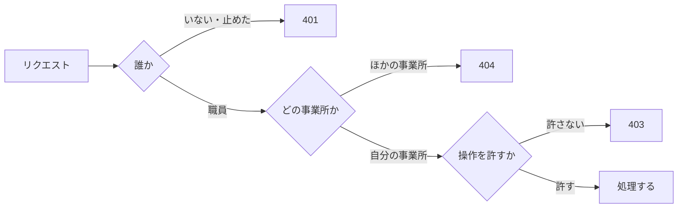

# 認可

状態: 下書き（2026-11-18）

役割ごとにしてよい操作と、API の入口での確かめ方を決める。役割を DB にどう持つかは [13_DB設計.md](13_DB設計.md)。ログインの方式は今の Identity Platform のままで、ここでは決めない。

## 役割

| 役割 | DB | 範囲 |
|---|---|---|
| ケアマネ | `staff.role` が `caremanager` | 自分の事業所 |
| 事業所の責任者 | `staff.role` が `admin` | 自分の事業所 |
| サイト管理者（私たち） | `site_admins` | 事業所に属さない。利用者の情報は見ない |

## 権限表

| 操作 | 中身 | ケアマネ | 責任者 | サイト管理者 |
|---|---|---|---|---|
| `care.work` | 利用者の登録、録音、AI の下書き、書類を作る・直す・保存する・PDF で出す、点検する・点検の結果に判断を付ける（点検は [16_書類と点検の基盤.md](16_書類と点検の基盤.md)） | ○ | ○ | × |
| `staff.manage` | 自分の事業所の職員を登録する・止める、役割を変える | × | ○ | × |
| `form.manage` | 自分の事業所の様式の PDF を上げる。変換の途中と結果を見る。下書きを直す・捨てる・公開する。録音から書くときの要約の項目を、足す・説明に書き足す（[17_録音からの書き込み.md](17_録音からの書き込み.md)） | × | ○ | × |
| `site.manage` | 事業所と、その最初の責任者を登録する。書類の種類と全体の様式を登録する | × | × | ○ |

責任者は、自分を止めたり、自分の役割を変えたりできない。事業所に責任者がいなくなるのを防ぐため。

## 確かめ方

職員の入口（`/api/...`）では、次の 3 段を順に確かめる。

| 段 | 確かめること | 読むもの | だめなとき |
|---|---|---|---|
| 1. 誰か | ID トークンの uid が `staff` にあり、`disabled_at` が空 | ID トークン、`staff` | 401 |
| 2. どの事業所か | 読み書きする行の `office_id` が、職員の `office_id` と同じ | `staff.office_id`。リクエストの値は使わない | 404。ほかの事業所の情報は「無い」ことにする |
| 3. 操作を許すか | 入口が宣言した操作を、その役割に許している | 権限表（コード） | 403 |

サイト管理者の入口（`/api/admin/...`）では、uid が `site_admins` にあるかだけを確かめる。なければ 403。

## 決まり

- 役割と停止は、リクエストのたびに DB の `staff` から読む。トークンのカスタムクレームには入れない。止めたり役割を変えたりしたら、すぐ効くようにするため（クレームだと、トークンが新しくなるまで最大 1 時間効かない）
- 権限表はコードの 1 か所にだけ置く。API の入口は、それぞれ操作を 1 つ宣言する。宣言のない入口はテストで落とす
- ログインなしの入口は、動いているかの確かめ（`/api/health.json`）と、ローカルの置き場だけの開発用の入口（送信と様式のファイル。ログインの代わりに置き場が出した期限つきの署名で確かめる。本番の置き場では 404）だけ。入口では `public` と宣言する
- 3 段目（操作を許すか）は、行を読む前に入口で確かめる。役割が許さない操作は、行がどの事業所のものでも 403 になる（ほかの事業所の行があるかどうかは分からない）
- サイト管理者の入口からは、利用者の情報を持つ表を読まない
- 職員を登録するとき（責任者の `staff.manage`）と、事業所の最初の責任者を登録するとき（サイト管理者の `site.manage`）は、api が Identity Platform のアカウントを作る（2026-11-19 に決めた。画面からのアカウント作成は禁止のまま）。パスワードは、本人がパスワードを決めるメールから決める。そのアカウントが、もうどこかの職員かサイト管理者なら登録しない（409）。とらなかった案: アカウントは私たちが Identity Platform の画面で作り、初めてのログインでメールが同じ職員の行に結ぶ（api に強い権限が要らない代わりに、職員を足すたびに私たちの作業が要る）
- 責任者が `form.manage` で変えられるのは、自分の事業所の様式（`office_id` が自分の事業所）だけ。全体の様式（`office_id` が空）は変えられない（403）
- 様式の PDF とページの画像の期限つき URL は、様式が自分の事業所のものか全体のものなら出す。ほかの事業所の様式は 404（置き場は [13_DB設計.md](13_DB設計.md) の「PDF の置き場」）
- 責任者が様式を登録する入口は `/api/office/...` に置く。職員の入口なので 3 段で確かめ、操作は `form.manage`
- 責任者が要約の項目で変えられるのは、自分の事業所の足した項目と書き足しだけ。全体の項目は、サイト管理者の入口（`/api/admin/...`）からだけ変えられる
- 点検（始める・結果を見る・判断を付ける）も、2 段目は点検した利用者の `office_id` で確かめる。ほかの事業所の利用者の点検は 404
- 役割を足すときは、権限表に列を足し、`staff.role` の CHECK に値を足す。事業所に属さない役割は `staff` に入れず、サイト管理者と同じく入口と表を分ける

## テスト

API の入口ごとに、宣言した操作の列について、使う人ごとの結果を確かめる。

| 使う人 | `care.work`（自分の事業所） | `care.work`（ほかの事業所） | `staff.manage` | `form.manage`（自分の事業所の様式） | `site.manage` |
|---|---|---|---|---|---|
| ケアマネ | 200 | 404 | 403 | 403 | 403 |
| 責任者 | 200 | 404 | 200 | 200 | 403 |
| 止めた職員 | 401 | 401 | 401 | 401 | 403 |
| サイト管理者 | 401 | 401 | 401 | 401 | 200 |
| ログインしていない人 | 401 | 401 | 401 | 401 | 401 |

あわせて確かめること:

- 責任者がほかの事業所の職員を指すと 404
- 責任者が自分を止める・自分の役割を変えると 403
- 責任者がほかの事業所の様式・上げた PDF を指すと 404
- 責任者が全体の様式を変えようとすると 403
- ほかの事業所の様式の PDF の URL を求めると 404（ケアマネも責任者も）
- ほかの事業所の利用者の点検を始める・結果を見る・判断を付けると 404（ケアマネも責任者も）
- 責任者が要約の項目を直しても、ほかの事業所の項目は変わらない。ケアマネが直そうとすると 403

## 未決
