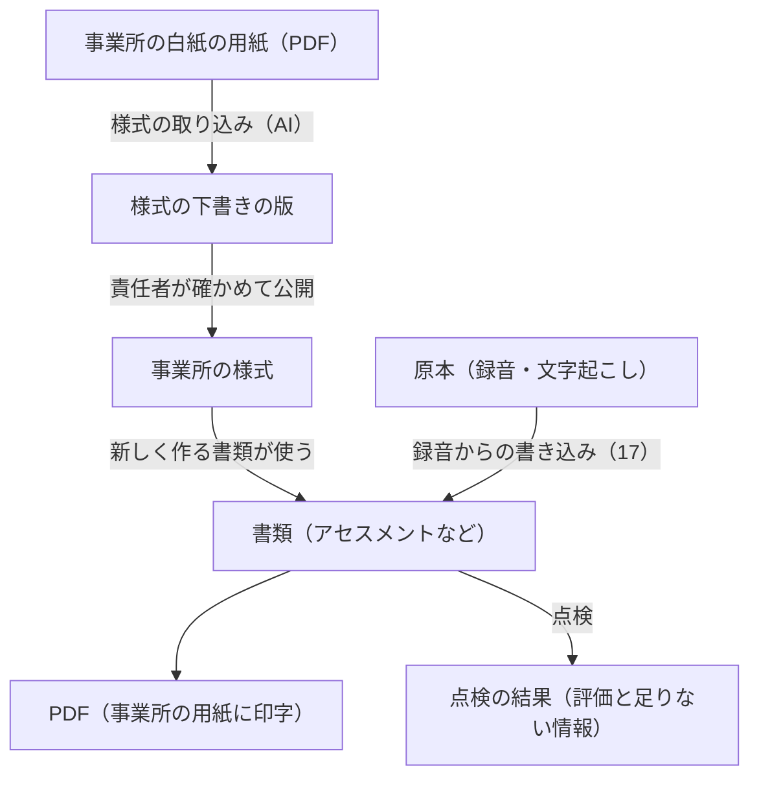
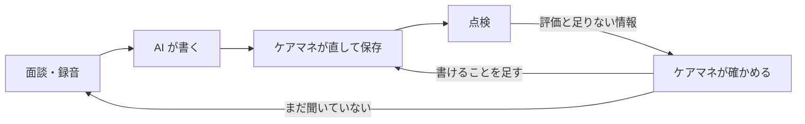

# 書類と点検の基盤

状態: 下書き（2026-11-18。AI 点検は 2026-11-20 に、決まった画面に合わせて直した）

主題は 2 つ。1 つは、事業所の独自の用紙（様式）を取り込み、その用紙で書類を作れるようにすること。もう 1 つは、AI によるケアプラン点検を今のサービスに入れること。どちらも、書類の種類と様式によらない同じ形で動かす。表の形は [13_DB設計.md](13_DB設計.md)、誰が何をしてよいかは [14_認可.md](14_認可.md)。13 で「別に考える」とした、DB を使うコードの変え方もここに書く。録音から AI が書く仕組みは [17_録音からの書き込み.md](17_録音からの書き込み.md)。

## 決めたこと（2026-11-18）

| 決めたこと | 中身 |
|---|---|
| 事業所の様式 | 責任者が、今使っている白紙の用紙（PDF）を上げる。AI が様式の下書きにし、責任者が確かめて直し、公開する。新しく作る書類から事業所の様式になり、すでにある書類は作ったときの版のまま。書類の種類は、サイト管理者だけが足す（13） |
| 種類ごとの動きは行で持つ | 書類の種類ごとの動きは `form_kinds` の列で持つ。コードは種類の名前を知らない |
| 値は書類ごとに持つ | どの値も、どれか 1 つの書類の値。基本情報（氏名・住所など 7 欄）を書類をまたいで 1 つに持つ仕組み（fields.json の `shared`）はやめる。どの書類で直しても、ほかの書類の値は変わらない |
| 写したあとは同期しない | 書類を作るときは、元にする種類の書類から同じ key の値をそのまま写す（今と同じ）。写した値を直しても、元の値を直しても、もう片方は変わらない。書類どうしの食い違いを知らせる機能（「反映」「今の記載を維持」）はやめる |
| AI 点検 | 厚労省の点検項目をデータにし、プログラムと AI で判定する。点検は値を変えない。段階が 1 の項目が 1 つでもあれば書類は「要確認」、どれも 2 以上なら「適合」（2026-11-19）。画面に出すのは評価と 32 項目それぞれの結果だけで、根拠と直しの案は出さない（2026-11-20） |

とらなかった案: 利用者の情報を利用者ごとに 1 つ持ち、主な書類はそれをそのまま見せ、ほかの書類は作るときに写す。持ち場と書類の種類の組み合わせで決まりと例外が増え、設計も操作もややこしくなるのでやめた。

## 全体の形

AI の仕事は次の 4 つ。どれも、根拠にないことは書かない。値を変える入口は、AI の書き込み（`applyBatch`）とケアマネの直し（`PATCH /api/documents/:id/fields` と用紙の直し）だけ。ケアマネが書いた値は、AI は書き換えない。

| 仕事 | 入力 | 出力 | 入る先 |
|---|---|---|---|
| 様式の取り込み | 事業所の白紙の用紙（PDF） | 様式の下書きの版 | 責任者が確かめて公開する |
| 録音からの書き込み（17） | 録音の文字起こし | 項目ごとの要約と、録音がつながった書類の欄の値 | AI の書き込み |
| 点検 | 書類の値 | 項目ごとの段階と、段階が 1 のときの足りない情報 | 点検の結果（値は変えない） |
| 書き方の相談（チャット） | ケアマネの頼み | 答えと直しの案 | 案はケアマネが入れる |

## 事業所の様式

### 様式の取り込み

PDF から位置と対応をどう作るかは決めない（黒箱）。決めるのは段と出口と確かめ方だけ。

| 段 | 出口 | 通す確かめ |
|---|---|---|
| 1. 受け付け | `form_imports` の行と、置き場の `imports/<import_id>.pdf`（13） | PDF として開ける |
| 2. 登録済みの様式と照らす | 全体の様式と同じ用紙なら、変換せずに `matched` で終える。事業所はそのまま全体の様式を使う | — |
| 3. 変換（黒箱） | 下書きの版（`schemas`・`bindings`・`pages`・`local_fields`）と、確かめてほしい欄の一覧（`form_imports.review`） | 13 の「様式を公開する前の確かめ」と、見本のデータで全部の印字欄が描けること |
| 4. 責任者が確かめて直す | 直した下書き（下書きの間は版を直せる。13） | 同上 |
| 5. 公開 | 公開した版。新しく作る書類から使う（13） | 同上 |

- 2 で「同じ」とするかの判断も黒箱の中で行う。PDF の中身のハッシュが同じなら、必ず同じとする。
- 責任者の画面では、見本のデータを入れた下書きと、印字欄ごとの対応（どの欄の値を出すか）の一覧を並べる。位置は pdfme の Designer で、対応は欄の一覧から選び直して直す（見た目は別に描く）。
- 変換の精度は、手作りした全体の 2 様式（アセスメント 1,223 か所、入院時情報提供書 141 か所）の白紙を変換にかけ、正解と比べて測る。見るのは、印字欄の見つけ漏れと余分、対応の一致、責任者が直す数。

### 欄の辞書（版ごと）

fields.json と、その版の `local_fields`（13）を合わせて「版の欄の辞書」にする。値の型の確かめ、印字欄との対応、AI に渡す欄の定義、チャットの道具は、どれもこの辞書を使う。今は fields.json だけを直接読んでいるので、その様式だけの欄（`local.*`）を扱えない。

fields.json は次のように変える。

| 変更 | 属性 | 説明 |
|---|---|---|
| やめる | `shared` | 値は書類ごとに持つため |
| 移す | `required.assess` | `form_kinds.required` へ |
| 役目を変える | `forms` | 全体の 2 様式の確かめと、人が読む説明にだけ使う。AI が書く欄と用紙での場所は、様式の版から決める |
| やめる | `item23` | 録音からの書き込みを、まとめる項目と、AI が欄を選ぶ形にしたため（17） |

### 録音から AI が書く欄

事業所の様式で作った書類にも、全体の様式と同じ仕組みで AI が書けるようにする。書き方の流れは 17。ここでは、様式の側から決まる「書いてよい欄」だけを決める。

| | 今 | 変えたあと |
|---|---|---|
| 録音のつながり先 | アセスメント | 録音を始めた書類（今の画面ではアセスメント） |
| 書いてよい欄 | fields.json で「アセスメント用紙にある」とした欄 | 録音がつながった書類の様式の版が読む欄のうち、出どころに会話・書類・案がある欄（図は除く）。その様式だけの欄は、説明書き（`local_fields` の `note`）があるもの |

- 全体のアセスメントの様式では、書いてよい欄は今と同じになる（版が読む key と fields.json の `forms.assess` は、`forms:check` で一致を確かめているため。テストで固定した）。
- 出どころが書類だけの欄（被保険者証の要介護度など）は、記録に書類があるときだけ書く（今と同じ）。録音は会話だけなので、録音から実際に書くのは、出どころに会話か案がある欄になる。
- 仕組み: 版の欄の辞書は `core/dictionary.ts`（`fieldDict`・`writableFields`）。

### 書類の種類ごとの動き

種類ごとの動きは `form_kinds` の列で持つ（13）。コードは、種類の名前ではなく、この列を見て動く。最初の行（今の 2 種類）の値は 13。

| 動き | 列 | 今のコードの決め打ち |
|---|---|---|
| 利用者を作るときに一緒に作る。利用者一覧の氏名・要介護度・入力の進み具合はこの書類から出す | `is_primary` | 利用者を作る処理と一覧が、アセスメントを名指ししている |
| 作るときに同じ key の値を写す元の種類 | `create_from` | 写しの処理が、元と先の種類を名指ししている |
| 必須の欄 | `required` | fields.json の `required.assess` |
| 録音から書くときのまとめる項目（日付を入れる欄、最後に書く項目を含む）と、要約を前の回に足していくか | `topics`・`summary_mode`（17） | worker が、アセスメントの日付の欄と、23 項目のまとまりを名指ししている |
| 1 人に何通作るか | `per_client` | 一意の制約 |

種類を足すときは、サイト管理者が `form_kinds` に 1 行と全体の様式を登録する。コードは変えない。どの事業所でも使う欄が足りなければ、fields.json に足す（デプロイが要る）。

### 書類を作る

| 段 | すること |
|---|---|
| 1. 様式を選ぶ | 事業所の様式があればそれ、なければ全体の様式の、公開した版を使う（今と同じ） |
| 2. 同じ key を写す | `create_from` の種類の書類（何通もある種類なら一番新しいもの）の今の値から、新しい書類の様式の版が読む key と同じ key の値を、そのまま写す。その様式だけの欄（`local.*`）は写さない |
| 3. 設定を入れる | 事業所の設定の欄（事業所名・電話・FAX・担当ケアマネの氏名） |

- どれも書類を作るリクエストの中で終える（今と同じ）。AI は使わない。
- 写した値と設定は、今と同じく AI の値として入り（書き込みの記録は `copy`）、ケアマネが直すとケアマネの値になる。
- 1 人 1 通の種類で、すでに書類があれば、作らずに今の書類を返す（今と同じ）。
- 今との違いは 2 つ。種類の名前ではなく `form_kinds` の行で動くこと。基本情報の 7 欄も写すこと（今は利用者に 1 つなので写さない）。

### 値の持ち方

| | 今 | 変えたあと |
|---|---|---|
| 基本情報の 7 欄（氏名・性別・生年月日・年齢・郵便番号・住所・電話） | 利用者に 1 つ。どの書類で直しても全部の書類に入る | 書類ごと。直した書類だけが変わる |
| 直したあとのお知らせ | 「ほかの書類にも入りました」と出す | 出さない |
| 書類を作るときに写した欄 | 元が変わると食い違いを知らせ、「反映」か「今の記載を維持」を選ぶ | 写すだけ。食い違いは知らせない |
| 利用者一覧の氏名 | どの書類で氏名を直しても変わる | 主な書類（アセスメント）の氏名を直したときだけ変わる |

例: アセスメントの住所を直した。同じ利用者のほかの書類の住所は、そのまま。変えたいときは、その書類の住所を直す。

DB の変更（`field_values` の移行、使わなくなる表）は 13 の「値の持ち方」。

### 書き方の相談（チャット）

- 印字欄の対応・欄の辞書・必須の欄を、開いている書類の版と種類から読む（今はリポジトリの様式のファイルを読む）。事業所の様式でも、用紙に印字するときだけ付く印の説明が合うようにするため。
- 道具（用紙を読む・足りない欄・録音を探す・書き換えの案）と、案はケアマネが押したときだけ入る決まりは、今のまま。

## AI 点検

### 位置づけ

書類を作る流れの後ろに付く「確かめ」の段。書類の値を読むだけで、値は変えない。ケアマネのセルフチェックとして使う。点検は不備を指摘するためではなく、振り返りと気づきのためのもの、という点検項目マニュアルの考えに合わせる。

点検が出すのは、書類の評価と、項目ごとの結果だけ（2026-11-20）。根拠と直しの案は出さない。根拠のない情報を、ケアマネが無理に用紙に入れることにつながるため。足りない情報をどう埋めるか（次の面談で聞く、主治医に確かめる、など）はケアマネが決める。

書類の判定（2026-11-19）:

| 項目の段階 | 書類の判定 |
|---|---|
| 1 の項目が 1 つでもある | 要確認 |
| どの項目も 2 以上 | 適合 |

項目ごとに出すこと（2026-11-20）:

| 項目の段階 | 出すこと |
|---|---|
| 2 以上 | ✓ だけ。理由は出さない |
| 1 | 何が足りないかを、ケアマネに分かる短い言葉で（例「量（mL など）が書かれていない」）。その書類の様式に欄がない項目には「用紙に欄なし」と添える |
| 他（例: 18 で「見守り」項目がない） | 足りない項目に数えない。✓ を付け、満たしている項目に数える |
| 点検していない（書類がない第1〜5表の 30 項目） | 判定にも一覧にも入れない |

公式の点検支援ツール（Excel）は、点検する人が 62 項目を読んで結果を入れ、重みで「記載の充実度」A〜E と分類ごとの点数を出す。ここでは、人が行っている「書類を読んで項目ごとに判定する」ところを AI にする。A〜E と重みつきの点数は作らない（ツール独自の指標で、適切さの判定ではないため）。分類ごとには、満たしている項目の数を数えて出す（下の「見せ方」）。

### 物差し（点検項目のデータ）

- 元は厚労省の「ケアプラン点検項目」（令和7年度の事業、2026 年 3 月）。62 項目で、アセスメント 32・第1表 2・第2表 9・第3表 4・第4表 8・第5表とモニタリング 6・その他 1。
- 版つきのデータにする。最初は fields.json と同じくリポジトリのデータに置く。名前と版（例 `mhlw-careplan@2026-03`）と中身の指紋で、どの物差しで点検したかを残す。
- 公開のリポジトリには、項目名と評価基準だけを、出典（厚労省の掲載ページ）を付けて入れる。点検項目マニュアルの解説は、要点だけを自分の言葉で書く（2026-11-19）。

| 属性 | 中身 | 例（13 BMI） |
|---|---|---|
| `id`・`name` | 番号と名前 | `13`・BMI |
| `docs` | 見る書類の種類 | `assessment` |
| `levels` | 段階と基準（2〜3 段階と「他」） | 2: BMI が書いてある／1: 書いていない |
| `criteria` | 段階を決める下位の観点（①②…） | — |
| `category` | 分類（ケアプラン点検支援ツールの「分類」の列のとおり。7 つ） | 疾病・心身状態の把握 |
| `operational` | 運営基準に関わる項目か | いいえ |
| `method` | プログラム（`rule`）、AI（`ai`）、両方 | 両方 |
| `keys` | 先に見る欄（手がかり。ほかの欄の文章も読む）。画面で項目を押したときに移る欄にも使う | 身長・体重 |
| `guide` | 確認の必要性と留意事項（AI の指示文に使う） | — |

アセスメントの 32 項目は、7 つの分類のうち 5 つに入る（生活の全体像の把握 13、疾病・心身状態の把握 10、主訴・意思の把握・尊重 3、課題の分析 4、家族の状況の把握と支援 2）。残りの 2 つ（課題を解決するためのサービス計画、多職種との連携）は、ケアプランの項目だけでできている。

点検は欄の値だけでなく、特記などの文章も読む。点検項目が見る情報のうち、fields.json に決まった欄がないもの（1 日の水分量、BMI、本人の役割、使える介護費用、外出先、転倒・骨折のリスク、エコマップ）があるため。事業所の様式で作った書類も、欄の辞書（版ごと）を通して同じように読む。その書類の版の欄の辞書に、項目の `keys` の欄が 1 つもないときは、画面で「用紙に欄なし」と添える。

### 点検できる範囲

- 今点検できるのは、アセスメントの 32 項目。第1〜5表を見る 30 項目は、その書類がないので「点検していない」と出す。
- ケアプラン（第1〜3表）は、このサービスで作る（2026-11-19。別の設計で進めている）。作れたら、第1〜3表の 15 項目（33〜47 番）を点検に足す。
- 家族構成図のような図を見る項目も、ほかの項目と同じに判定する（2026-11-20）。「ケアマネが答える」のような別の扱いは作らない。図を AI が読み書きする仕組みは別に作る（#132）。

### 流れ

録音と同じく裏の仕事にする（13 の `inspections`）。画面は進み具合を読む。

| 段 | すること |
|---|---|
| 1. 集める | 物差しの `docs` の書類の値を「欄の名前: 値」の文字にする（チャットの「用紙を読む」と同じ部品）。読んだ値の指紋を残す（前の点検のあとに書類が変わったかを出すため） |
| 2. プログラムで判定 | 決まりで判定できる観点を見る。書いてあるか（BMI、かかりつけ医）、日付の範囲（長期目標の期間が認定の有効期間の中か）、表どうしの整合（第2表と第3表の回数） |
| 3. AI で判定 | 残りの観点を AI が判定し、項目ごとに段階と観点ごとの当否を付ける。段階が 1 の項目には、何が足りないかの短い言葉を付ける。項目はまとめて呼び、指示文の先頭を書類にそろえてキャッシュに当てる |
| 4. 残す | 項目ごとの結果と、画面で押したときに移る欄を残す（13 の `inspection_findings`） |

録音からの書き込みと同じく、点検でも足りないところを推測で埋めない。点検は録音を読まず、直しの案も作らない（2026-11-20）。

### 見せ方

画面の決定版（#134 で合意、2026-11-20）: https://claude.ai/artifact/La1RqwX2TgoBN8eyRtfyPi

| 場面 | 出すもの |
|---|---|
| 入口 | ペットのメニューの「点検する」。小さい字で状態を出す（まだ点検していません／点検しています…／要確認 6件／適合） |
| 初めて | 結果の画面の形のまま、中が空のカードに「点検を始める」。押すと同じカードに進み具合が出て、終わるとそこに結果が入る。点検は裏で動き、待つあいだも用紙を直せる |
| 結果 | 猫のふきだしで評価を伝える（「点検の結果は［要確認］です。32 項目のうち 6 項目で、情報が足りません。」）。その下のカードに、評価の札、「もう一度点検する」、日時と点検した人、満たしている・足りないの帯、分類ごとのレーダーチャート、32 項目の結果 |
| 分類ごと | アセスメントの 32 項目が入る 5 つの分類ごとに、「満たしている項目の数 / 項目の数」をレーダーチャートで出す。足りない項目がある分類は、点の色を変える |
| 32 項目の結果 | 点検項目の順に全部（上の「項目ごとに出すこと」）。欄がある足りない項目は、押すと用紙のその場所へ移る |
| 2 回目から | 「点検する」で最新の結果が開く。「もう一度点検する」はカードの上にいつも置く。前の点検のあとに読んだ書類の値が変わっていれば、猫の言葉が「前の点検（日時）のあとに、用紙が変わっています。もう一度点検しますか？」に替わる |
| これまでの点検 | 結果の下に新しい 3 件（日時・点検した人・評価・足りない数・前回との差）。それより前は「前の点検をすべて見る」で月ごとに開く。押すとその回の結果になり、「○/○ の点検を見ています」の帯と「最新の結果に戻る」を出す。そのあいだ「もう一度点検する」は出さない |

作らないもの（2026-11-20）: 根拠、直しの案と「用紙に入れる」、ケアマネの判断（この評価でよい・段階を直す・該当しない）とその引き継ぎ・「見直し」、項目ごとの「点検のあとに用紙が変わりました」、点検の移り変わりの棒グラフ。

### 例

演習シナリオの 2 回目の正解シートを点検したときに、AI がこう付けるはず、という想定。

| 項目 | 段階 | 画面に出すこと |
|---|---|---|
| 20 利用者の主訴・要望 | 3 | ✓ |
| 12 食事内容・カロリー数等 | 2 | ✓（必要な食事の量がないが、2 なので理由は出さない） |
| 10 一日に摂取すべき水分量 | 1 | 「量（mL など）が書かれていない」「用紙に欄なし」 |
| 13 BMI | 1 | 「BMI の数字が書かれていない」「用紙に欄なし」（身長・体重が書いてあっても、BMI がなければ 1） |

この書類の判定は「要確認」（10 と 13 が 1）。

### 費用

上限は、点検 1 回 100 円（2026-11-19）。演習シナリオで測り、上限に収まることを確かめてから出す（測る前に見積もりを出す）。録音と同じく、段ごとのトークンと円を残す。

## 今のサービスへの入れ方

### API の変更

職員の入口は `/api/...`、サイト管理者の入口は `/api/admin/...`（14）。責任者が様式を登録する入口は `/api/office/...` に置く（職員の入口。操作は `form.manage`）。

| 変更 | メソッドとパス | 中身 | 操作（14） |
|---|---|---|---|
| 変える | `POST /api/clients` | 主な書類（`form_kinds.is_primary`）も作る。応答の `assessmentId` を `documentId` にする | `care.work` |
| 変える | `GET /api/clients` | 一覧の要介護度・入力の進み具合を、主な書類から読む | `care.work` |
| 足す | `GET /api/form-kinds` | 種類と、その事業所で使える様式があるか。作業画面のタブと「＋ 書類を作る」が使う | `care.work` |
| 変える | `POST /api/clients/:id/documents` | 本文を `{kind}` にし、どの種類も「書類を作る」の流れで作る（今は入院時情報提供書だけ） | `care.work` |
| なくす | `GET /api/documents/:id/sync-differences`、`POST /api/documents/:id/sync-decisions` | 食い違いを知らせる機能をやめる | — |
| 変える | `PATCH /api/documents/:id/fields`、`POST /api/documents/:id/edits` | 応答から `syncedTo`（ほかの書類にも入った書類の名前）をなくす | `care.work` |
| 変える | `POST /api/clients/:id/recordings` | 本文に `documentId`（録音を始めた書類）を足す。省いたときは主な書類 | `care.work` |
| 変える | `POST /api/documents/:id/chat` | 印字欄の対応・欄の辞書・必須の欄を、書類の版と種類から読む | `care.work` |
| 足す | `POST /api/clients/:id/inspections` | 点検を始める（`{checkSet}`）。`202 {inspectionId}` | `care.work` |
| 足す | `GET /api/clients/:id/inspections` | これまでの点検（新しい順。日時・点検した人・状態・評価・足りない項目の数）。メニューの「点検する」の状態にも使う | `care.work` |
| 足す | `GET /api/inspections/:id` | 状態、評価（要確認・適合）、32 項目それぞれの段階（段階が 1 なら足りない情報と、押したときに移る欄。欄がなければ空）、分類ごとの数。いちばん新しい点検なら、そのあとに読んだ書類の値が変わったか | `care.work` |
| 足す | `POST /api/office/form-imports`、`POST /api/office/form-imports/:id/complete`、`GET /api/office/form-imports/:id` | 用紙の PDF を上げる（送り先の URL を返す）、送り終わり、変換の途中と結果 | `form.manage` |
| 足す | `GET`・`PATCH`・`DELETE /api/office/form-versions/:id`、`POST /api/office/form-versions/:id/publish` | 下書きを見る・直す・捨てる・公開する | `form.manage` |
| 足す | `/api/admin/form-kinds`、`/api/admin/form-imports` | 種類と、全体の様式を登録する | `site.manage` |

worker の道（非公開）:

| 変更 | メソッドとパス | 中身 |
|---|---|---|
| 足す | `POST /tasks/inspections/:id/run` | 点検 |
| 足す | `POST /tasks/form-imports/:id/run` | 様式の取り込み |
| 変える | `POST /tasks/reconcile` | 今の `jobs` に加え、`inspections`・`form_imports` の、積み損ねと止まった仕事を積み直す |

### コードで変えるところ

| 区分 | 場所 | 中身 |
|---|---|---|
| 残す | 印字欄の対応の種類（`core/binding.ts` の op）、書き換えの決まり（`core/apply-batch.ts`）、保存の 3 段・版・PDF、文字起こしと話した人、bench | そのまま（録音からの書き込みで残すものは 17） |
| なくす | `core/document-sync.ts`、書類どうしの食い違いの処理（`db/repo.ts`）、画面の `SyncDifferences`、基本情報を書類をまたいで書く処理 | 決めたことのとおり |
| 変える | `core/fields.ts`・`core/schema.ts`・`core/binding.ts` | 版の欄の辞書を引数で受ける。`shared` と `required.assess` を読まない |
| 変える | `core/form.ts` | 種類の決め打ち（`FormKind`）をやめ、`form_kinds` の行で動く |
| 変える | `db/repo.ts` | 書類を作る処理を 1 つにする（`create_from` から写す・設定を入れる）。値はいつも書類の行に書く。一覧の氏名を主な書類から書き換える。録音を、録音を始めた書類につなぐ |
| 変える | `worker/jobs.ts` | 期限つきの印・段・見回りを、3 つの表（`jobs`・`inspections`・`form_imports`）で使う共通の関数にする。録音の段の作り替えは 17 |
| 作り替える | `worker/vertex/` | 17 |
| 変える | `api/chat.ts` | 対応・辞書・必須を版と種類から読む。用紙を読む処理を、点検と共通の部品にする |
| 変える | 画面（PC と iPad の作業画面、「＋ 書類を作る」） | タブとメニューを `GET /api/form-kinds` から作る。食い違いの表示をなくす。必須の欄を種類の `required` から読む |
| 変える | `forms/admin/check.ts` | fields.json の `forms` との一致は、全体の様式だけに求める |
| 足す | 点検の物差し（`core/checks/`） | 62 項目のデータと、プログラムで判定する観点の関数 |
| 足す | `worker/inspect/`・`worker/form-import/` | 点検、様式の取り込み（中は黒箱） |
| 足す | 画面: ペットの「点検する」、責任者の「様式の登録」 | 点検は「見せ方」の決定版のとおり。様式の登録の見た目は別に描く |

### 入れる順

| 段階 | 中身 | 前に要るもの | 画面の変化 |
|---|---|---|---|
| 0. 土台 | `shared` をやめる（1 回目の移行）。食い違いを知らせる機能をやめる。`form_kinds` の列で動かす。版の欄の辞書。チャットが版を読む | なし | 「ほかの書類にも入りました」のお知らせと、食い違いの表示がなくなる |
| 1. 事業所の様式の登録 | 13 の表、様式の取り込み、責任者の確かめと公開 | 0。取り込みの正解（全体の 2 様式）と、公開されている白紙の用紙 | 様式の登録の画面 |
| 2. 点検（アセスメントの 32 項目） | 物差し、点検の流れ、結果とこれまでの点検、「点検する」 | 0。点検の正解（演習シナリオの正解シートに段階を付け、ケアマネの経験がある人に確かめてもらう） | 点検の画面 |
| 3. 点検を広げる | 第1〜3表の 15 項目を点検に足す | 2。ケアプランを作る仕組み（別の設計） | 点検の項目が増える |
| 4. 第4表・第5表・モニタリング | 記録の種類を足す | 3 | — |

- 0 のあとの 1・2 は互いに依存しないので、並べて進められる。録音からの書き込みの作り替え（17）も、これらと並べて進められる（17 の「Issue の分け方と順」）。`shared` をやめる移行は、2 回とも 0 で新しいコードと一緒に流す（13）。
- どこまでを今回の開発期間に入れるかは、作る速さの見積もりでは決めない。見せる話（事業所の用紙を上げる → 録音から、その用紙で書類ができる → 点検で抜けが分かる → 直す・次の面談で聞く）が途中で切れないかで決め、上から順に進める。

### テスト

新しい決まりは Red（落ちるテスト）から書く。今の動きを固定するテストは、意図どおり Red にならない。

| 段階 | 先に書くテスト | 種類 |
|---|---|---|
| 0 | 書類の作成・直し・保存・PDF・事業所の分けが、今と同じに動く。印字欄の表示（`test/binding.test.ts` の 2,830 組）が変わらない | 今の動きの固定 |
| 0 | 1 回目の移行の前と後で、どの書類にも同じ値が見える | 今の動きの固定 |
| 0 | ある書類の住所を直しても、同じ利用者のほかの書類の住所は変わらない。書類を作るときに同じ key の値が写り、写したあとにどちらを直しても、もう片方は変わらない。一覧の氏名は、主な書類の氏名を直したときだけ変わる | Red から |
| 0 | `form_kinds` に行を足すだけで、新しい種類の書類を作れる | Red から |
| 0 | 書いてよい欄が版から決まり、その様式だけの欄（`local.*`）は説明書きのあるものだけ含む。チャットが事業所の様式の印の説明を読む | Red から |
| 1 | 公開前の確かめ。下書きを直す・捨てる・公開する権限（14 の `form.manage`）。公開したあとに作る書類だけが事業所の様式になり、すでにある書類は前の版のまま | Red から |
| 1 | 全体の 2 様式の白紙を変換し、正解と比べる（見積もりを出してから） | 精度の評価 |
| 2 | 物差しの形（62 項目あり、`rule` の観点には関数がある）。プログラムで判定する観点（BMI、期間が有効期間の中か） | Red から |
| 2 | 書類の判定（1 が 1 つでもあれば要確認、なければ適合。「他」は足りない項目に数えない）。32 項目すべての段階を返し、段階が 1 の項目にだけ足りない情報を付ける。段階が 2 以上の項目は理由を返さない。分類ごとの数。様式に欄がない項目は、移る欄が空 | Red から |
| 2 | これまでの点検の一覧と、前の回の結果を開ける。前の点検のあとに読んだ書類の値が変わったときだけ「変わった」になる。点検は値を変えない。権限（14 の `care.work`。ほかの事業所の点検は 404） | Red から |
| 2 | 欄を消すと段階が下がり、足すと上がる（本物の Gemini。見積もりを出してから） | 精度の評価 |

## 未決

今はない。2026-11-19 に次のとおり決めた。

| 問い | 決めたこと |
|---|---|
| 点検をケアプランへ広げるとき、ケアプランをどう入れるか | このサービスで作る。2026-11-08 の「1 回目ではケアプランを作らない」を変える。設計は別の文書で進めている |
| 点検項目の文面の扱い | 項目名と評価基準だけを、出典を付けて入れる。マニュアルの解説は要点だけを自分の言葉で書く |
| 費用の上限 | 点検 1 回 100 円 |

## 今は作らないもの

- 様式の登録の画面の見た目 → キャンバスで描いて相談する（点検の画面は 2026-11-20 に決まった。「見せ方」）
- 点検の根拠・直しの案・ケアマネの判断（段階を直す など）とその引き継ぎ。点検で録音を読むことと、面談のヒントへのつなぎ（2026-11-20 にやめた。根拠のない情報を用紙に入れることにつながるため）
- 様式の取り込みの変換（黒箱）の中身
- 事業所・市町村ごとの点検の物差し。作るときの持ち方は 13
- 点検の結果を点検項目の順の表で出すこと（市町村が使う点検支援ツールの「点検結果」の列に貼れる形）、点検の自動実行、事業所全体の点検の一覧
- 書類の写しの読み取りは #18 の対象に移した（下記）。
- 書類を作るときに、写した欄のほかの欄を AI が書くこと（例: アセスメントから入院時情報提供書を作る）。この文書の主題にしない（2026-11-18）。足すときも、値の持ち方（書類ごと、写したあとは同期しない）と、AI の書き込みの入口（`applyBatch`）はそのまま使える
- 写したあとに書類どうしの値をつなぐこと（2026-11-18 にやめた）

出典: 厚生労働省「ケアプラン点検について」（https://www.mhlw.go.jp/stf/seisakunitsuite/bunya/hukushi_kaigo/kaigo_koureisha/hoken/jissi_00005.html）の、ケアプラン点検項目、ケアプラン点検項目マニュアル（第 2.2 版・セルフチェック版）、ケアプラン点検支援ツールとそのマニュアル（第 2.0 版）。

## 記入済み書類の入力（#18、2026-11-20）

PDF・スキャンPDF・JPEG・PNGを、ケアマネの `care.work` から取り込む。白紙様式の変換とは分け、原本は `source/document-inputs/<事業所>/<利用者>/<取込ID>/original` に非公開保存する。`document_inputs` に対象書類・SHA-256・進行状態・ページ別読取・候補・採用済みキーを残す。同じ原本は対象書類の中で1件とする。

画像と抽出文字を共通Gemini基盤で読み、原文を `Visit.scenes.kind='書類'` として共通の要約→欄選択→書き込み→最終チェックへ渡す。原文の読取で項目の構造化や欄への割当は行わず、様式の対応を逆向きに使った書類専用マッピングも作らない。候補の範囲は版の欄の辞書とAIが書いてよい欄に限り、その様式だけの欄も同じ型検証を使う。要約ごとの原文IDを保持し、候補の要約根拠を原文へ戻す。

原本・ページ・原文・根拠ID・記録日（不明なら不明）は内部の出典として保持し、反映先・候補の確認・明示的な採用を経て、その書類にだけ反映する。読取時の値から変わった欄は409で全変更を取り消し、再送による二重採用を防ぐ。採用は人の編集として既存の型検証・書類ロック・履歴処理を使う。

APIは `POST/GET /api/documents/:id/inputs`、`GET /api/document-inputs/:id`、`POST .../complete`・`.../retry`・`.../adopt`、`GET .../original`。すべて `care.work` と事業所で認可する。workerは `/tasks/document-inputs/:id/run`、見回りは既存reconcileに追加する。リースと実行トークンで重複実行を防ぎ、読取済みページは再利用する。

実資料を送る前に処理地域と組織の利用条件を確認し、`DOCUMENT_INPUT_APPROVED_LOCATION` に確認した `GEMINI_LOCATION` を設定する（Terraformでは `document_input_approved_location`。既定は空）。fakeモードは読取結果を作らず、試用モードと表示する。精度・費用・確認所要時間の実測は受け入れ条件として別途必要。

### 2026-11-21：画像から簡単に記入するUI

目的は、入力したい情報の入った画像を添付し、開いているアセスメント等の書類へ反映すること。画像を選ぶと送信・読取を開始し、元の記載とAIの提案を「書き方を相談する」と同じ赤（削除）・緑（追加）の差分で表示し、項目ごとに反映するかどうかを選択してまとめて反映する。文章は文ごと、選択式も元の選択肢とAIの選択肢を比較する。表示部品 `ProposalDiff` と差分計算 `proposalChanges` を相談画面と共用する。候補のプルダウンや編集欄は設けない。修正が必要な場合は用紙の通常の編集を使う。原本ビューア、原文・根拠ID・記録日の表示、原本の本人確認チェック、旧3項目比較用読取は通常の導線から外す。既存値は上書き前に表示し、型検証・競合検出・内部の出典保持は継続する。

反映APIの `targetConfirmed: true` は、反映先の利用者名を表示したボタンの操作を意味する。原本の本人確認を代行したとは扱わない。添付処理は `attachDocumentInput` に分離する。将来「書き方を相談する」から同じ処理を利用する予定だが、相談画面への添付UIは今回追加しない。
