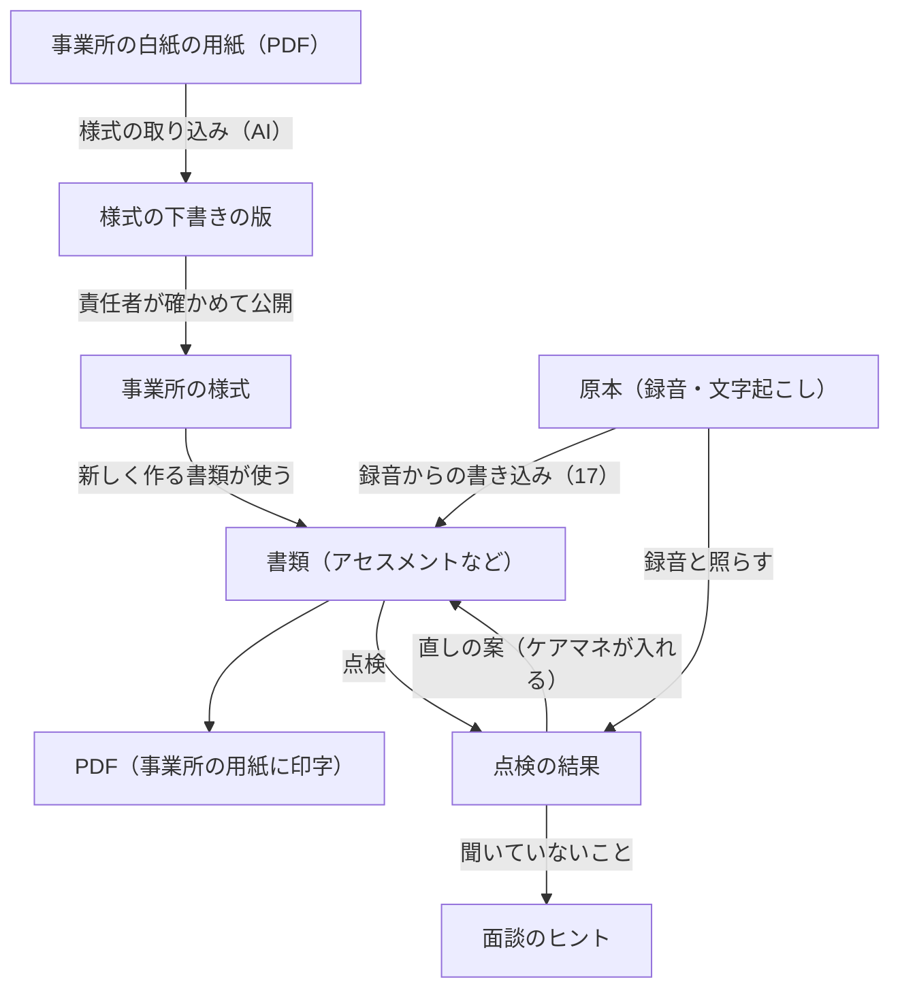
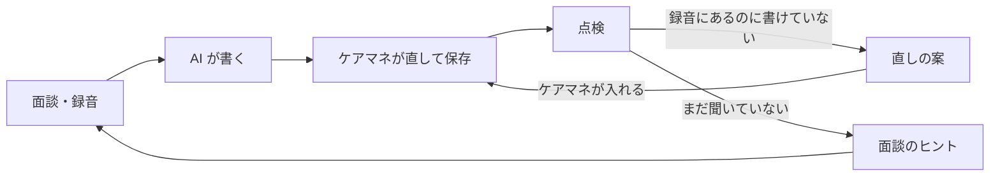

# 書類と点検の基盤

状態: 下書き（2026-11-18）

主題は 2 つ。1 つは、事業所の独自の用紙（様式）を取り込み、その用紙で書類を作れるようにすること。もう 1 つは、AI によるケアプラン点検を今のサービスに入れること。どちらも、書類の種類と様式によらない同じ形で動かす。表の形は [13_DB設計.md](13_DB設計.md)、誰が何をしてよいかは [14_認可.md](14_認可.md)。13 で「別に考える」とした、DB を使うコードの変え方もここに書く。録音から AI が書く仕組みは [17_録音からの書き込み.md](17_録音からの書き込み.md)。

## 決めたこと（2026-11-18）

| 決めたこと | 中身 |
|---|---|
| 事業所の様式 | 責任者が、今使っている白紙の用紙（PDF）を上げる。AI が様式の下書きにし、責任者が確かめて直し、公開する。新しく作る書類から事業所の様式になり、すでにある書類は作ったときの版のまま。書類の種類は、サイト管理者だけが足す（13） |
| 種類ごとの動きは行で持つ | 書類の種類ごとの動きは `form_kinds` の列で持つ。コードは種類の名前を知らない |
| 値は書類ごとに持つ | どの値も、どれか 1 つの書類の値。基本情報（氏名・住所など 7 欄）を書類をまたいで 1 つに持つ仕組み（fields.json の `shared`）はやめる。どの書類で直しても、ほかの書類の値は変わらない |
| 写したあとは同期しない | 書類を作るときは、元にする種類の書類から同じ key の値をそのまま写す（今と同じ）。写した値を直しても、元の値を直しても、もう片方は変わらない。書類どうしの食い違いを知らせる機能（「反映」「今の記載を維持」）はやめる |
| AI 点検 | 厚労省の点検項目をデータにし、プログラムと AI で判定する。点検は値を変えない。直しは案まで、入れるのはケアマネ。段階が 1 の項目が 1 つでもあれば書類は「要確認」、どれも 2 以上なら「適合」。知らせるのは 1 の項目だけ（2026-11-19） |

とらなかった案: 利用者の情報を利用者ごとに 1 つ持ち、主な書類はそれをそのまま見せ、ほかの書類は作るときに写す。持ち場と書類の種類の組み合わせで決まりと例外が増え、設計も操作もややこしくなるのでやめた。

## 全体の形

AI の仕事は次の 4 つ。どれも、根拠にないことは書かない。値を変える入口は、AI の書き込み（`applyBatch`）とケアマネの直し（`PATCH /api/documents/:id/fields` と用紙の直し）だけ。ケアマネが書いた値は、AI は書き換えない。

| 仕事 | 入力 | 出力 | 入る先 |
|---|---|---|---|
| 様式の取り込み | 事業所の白紙の用紙（PDF） | 様式の下書きの版 | 責任者が確かめて公開する |
| 録音からの書き込み（17） | 録音の文字起こし | 項目ごとの要約と、録音がつながった書類の欄の値 | AI の書き込み |
| 点検 | 書類の値と原本 | 項目ごとの段階・根拠・直しの案 | 点検の結果（値は変えない） |
| 書き方の相談（チャット） | ケアマネの頼み | 答えと直しの案 | 案はケアマネが入れる |

## 事業所の様式

### 様式の取り込み

PDF から位置と対応をどう作るかは決めない（黒箱）。決めるのは段と出口と確かめ方だけ。

| 段 | 出口 | 通す確かめ |
|---|---|---|
| 1. 受け付け | `form_imports` の行と、置き場の `imports/<import_id>.pdf`（13） | PDF として開ける |
| 2. 登録済みの様式と照らす | 全体の様式と同じ用紙なら、変換せずに `matched` で終える。事業所はそのまま全体の様式を使う | — |
| 3. 変換（黒箱） | 下書きの版（`schemas`・`bindings`・`pages`・`local_fields`）と、確かめてほしい欄の一覧（`form_imports.review`） | 13 の「様式を公開する前の確かめ」と、見本のデータで全部の印字欄が描けること |
| 4. 責任者が確かめて直す | 直した下書き（下書きの間は版を直せる。13） | 同上 |
| 5. 公開 | 公開した版。新しく作る書類から使う（13） | 同上 |

- 2 で「同じ」とするかの判断も黒箱の中で行う。PDF の中身のハッシュが同じなら、必ず同じとする。
- 責任者の画面では、見本のデータを入れた下書きと、印字欄ごとの対応（どの欄の値を出すか）の一覧を並べる。位置は pdfme の Designer で、対応は欄の一覧から選び直して直す（見た目は別に描く）。
- 変換の精度は、手作りした全体の 2 様式（アセスメント 1,223 か所、入院時情報提供書 141 か所）の白紙を変換にかけ、正解と比べて測る。見るのは、印字欄の見つけ漏れと余分、対応の一致、責任者が直す数。

### 欄の辞書（版ごと）

fields.json と、その版の `local_fields`（13）を合わせて「版の欄の辞書」にする。値の型の確かめ、印字欄との対応、AI に渡す欄の定義、チャットの道具は、どれもこの辞書を使う。今は fields.json だけを直接読んでいるので、その様式だけの欄（`local.*`）を扱えない。

fields.json は次のように変える。

| 変更 | 属性 | 説明 |
|---|---|---|
| やめる | `shared` | 値は書類ごとに持つため |
| 移す | `required.assess` | `form_kinds.required` へ |
| 役目を変える | `forms` | 全体の 2 様式の確かめと、人が読む説明にだけ使う。AI が書く欄と用紙での場所は、様式の版から決める |
| やめる | `item23` | 録音からの書き込みを、まとめる項目と、AI が欄を選ぶ形にしたため（17） |

### 録音から AI が書く欄

事業所の様式で作った書類にも、全体の様式と同じ仕組みで AI が書けるようにする。書き方の流れは 17。ここでは、様式の側から決まる「書いてよい欄」だけを決める。

| | 今 | 変えたあと |
|---|---|---|
| 録音のつながり先 | アセスメント | 録音を始めた書類（今の画面ではアセスメント） |
| 書いてよい欄 | fields.json で「アセスメント用紙にある」とした欄 | 録音がつながった書類の様式の版が読む欄のうち、出どころに会話か案がある欄。その様式だけの欄は、説明書き（`local_fields` の `note`）があるもの |

- 全体のアセスメントの様式では、書いてよい欄は今と同じになる（版が読む key と fields.json の `forms.assess` は、`forms:check` で一致を確かめているため）。

### 書類の種類ごとの動き

種類ごとの動きは `form_kinds` の列で持つ（13）。コードは、種類の名前ではなく、この列を見て動く。最初の行（今の 2 種類）の値は 13。

| 動き | 列 | 今のコードの決め打ち |
|---|---|---|
| 利用者を作るときに一緒に作る。利用者一覧の氏名・要介護度・入力の進み具合はこの書類から出す | `is_primary` | 利用者を作る処理と一覧が、アセスメントを名指ししている |
| 作るときに同じ key の値を写す元の種類 | `create_from` | 写しの処理が、元と先の種類を名指ししている |
| 必須の欄 | `required` | fields.json の `required.assess` |
| 録音から書くときのまとめる項目（日付を入れる欄、最後に書く項目を含む）と、要約を前の回に足していくか | `topics`・`summary_mode`（17） | worker が、アセスメントの日付の欄と、23 項目のまとまりを名指ししている |
| 1 人に何通作るか | `per_client` | 一意の制約 |

種類を足すときは、サイト管理者が `form_kinds` に 1 行と全体の様式を登録する。コードは変えない。どの事業所でも使う欄が足りなければ、fields.json に足す（デプロイが要る）。

### 書類を作る

| 段 | すること |
|---|---|
| 1. 様式を選ぶ | 事業所の様式があればそれ、なければ全体の様式の、公開した版を使う（今と同じ） |
| 2. 同じ key を写す | `create_from` の種類の書類（何通もある種類なら一番新しいもの）の今の値から、新しい書類の様式の版が読む key と同じ key の値を、そのまま写す。その様式だけの欄（`local.*`）は写さない |
| 3. 設定を入れる | 事業所の設定の欄（事業所名・電話・FAX・担当ケアマネの氏名） |

- どれも書類を作るリクエストの中で終える（今と同じ）。AI は使わない。
- 写した値と設定は、今と同じく AI の値として入り（書き込みの記録は `copy`）、ケアマネが直すとケアマネの値になる。
- 1 人 1 通の種類で、すでに書類があれば、作らずに今の書類を返す（今と同じ）。
- 今との違いは 2 つ。種類の名前ではなく `form_kinds` の行で動くこと。基本情報の 7 欄も写すこと（今は利用者に 1 つなので写さない）。

### 値の持ち方

| | 今 | 変えたあと |
|---|---|---|
| 基本情報の 7 欄（氏名・性別・生年月日・年齢・郵便番号・住所・電話） | 利用者に 1 つ。どの書類で直しても全部の書類に入る | 書類ごと。直した書類だけが変わる |
| 直したあとのお知らせ | 「ほかの書類にも入りました」と出す | 出さない |
| 書類を作るときに写した欄 | 元が変わると食い違いを知らせ、「反映」か「今の記載を維持」を選ぶ | 写すだけ。食い違いは知らせない |
| 利用者一覧の氏名 | どの書類で氏名を直しても変わる | 主な書類（アセスメント）の氏名を直したときだけ変わる |

例: アセスメントの住所を直した。同じ利用者のほかの書類の住所は、そのまま。変えたいときは、その書類の住所を直す。

DB の変更（`field_values` の移行、使わなくなる表）は 13 の「値の持ち方」。

### 書き方の相談（チャット）

- 印字欄の対応・欄の辞書・必須の欄を、開いている書類の版と種類から読む（今はリポジトリの様式のファイルを読む）。事業所の様式でも、用紙に印字するときだけ付く印の説明が合うようにするため。
- 道具（用紙を読む・足りない欄・録音を探す・書き換えの案）と、案はケアマネが押したときだけ入る決まりは、今のまま。

## AI 点検

### 位置づけ

書類を作る流れの後ろに付く「確かめ」の段。書類の値と原本を読むだけで、値は変えない。ケアマネのセルフチェックとして使う。点検は不備を指摘するためではなく、振り返りと気づきのためのもの、という点検項目マニュアルの考えに合わせる。

書類の判定（2026-11-19）:

| 項目の段階 | 書類の判定 | ケアマネに知らせること |
|---|---|---|
| 1 の項目が 1 つでもある | 要確認 | 段階が 1 の項目だけを知らせる（直しの案か、面談のヒント） |
| どの項目も 2 以上 | 適合 | 何も知らせない。直しは必須ではないため |

- 段階が 2 以上の項目は、知らせない。理由も直しの案も出さない。
- 「他」と「点検していない」項目は、判定に数えない。
- ケアマネが段階を直したときは、直した段階で判定し直す。判定は項目の結果から出す（持ち方は 13）。

公式の点検支援ツール（Excel）は、点検する人が 62 項目を読んで結果を入れ、重みで「記載の充実度」A〜E を出す。ここでは、人が行っている「書類を読んで項目ごとに判定する」ところを AI にする。A〜E は作らない（ツール独自の指標で、適切さの判定ではないため）。

### 物差し（点検項目のデータ）

- 元は厚労省の「ケアプラン点検項目」（令和7年度の事業、2026 年 3 月）。62 項目で、アセスメント 32・第1表 2・第2表 9・第3表 4・第4表 8・第5表とモニタリング 6・その他 1。
- 版つきのデータにする。最初は fields.json と同じくリポジトリのデータに置く。名前と版（例 `mhlw-careplan@2026-03`）と中身の指紋で、どの物差しで点検したかを残す。
- 公開のリポジトリには、項目名と評価基準だけを、出典（厚労省の掲載ページ）を付けて入れる。点検項目マニュアルの解説は、要点だけを自分の言葉で書く（2026-11-19）。

| 属性 | 中身 | 例（13 BMI） |
|---|---|---|
| `id`・`name` | 番号と名前 | `13`・BMI |
| `docs` | 見る書類の種類 | `assessment` |
| `levels` | 段階と基準（2〜3 段階と「他」） | 2: BMI が書いてある／1: 書いていない |
| `criteria` | 段階を決める下位の観点（①②…） | — |
| `category` | 分類 | 疾病・心身状態の把握 |
| `operational` | 運営基準に関わる項目か | いいえ |
| `method` | プログラム（`rule`）、AI（`ai`）、両方 | 両方 |
| `keys` | 先に見る欄（手がかり。ほかの欄の文章も読む） | 身長・体重 |
| `guide` | 確認の必要性と留意事項（AI の指示文と、ケアマネへの説明に使う） | — |

点検は欄の値だけでなく、特記などの文章も読む。点検項目が見る情報のうち、fields.json に決まった欄がないもの（1 日の水分量、BMI、本人の役割、使える介護費用、外出先、転倒・骨折のリスク、エコマップ）があるため。事業所の様式で作った書類も、欄の辞書（版ごと）を通して同じように読む。

### 点検できる範囲

- 今点検できるのは、アセスメントの 32 項目。第1〜5表を見る 30 項目は、その書類がないので「点検していない」と出す。
- ケアプラン（第1〜3表）は、このサービスで作る（2026-11-19。別の設計で進めている）。作れたら、第1〜3表の 15 項目（33〜47 番）を点検に足す。
- 書類があっても AI が判定できない項目（家族構成図のように、用紙に手で描く図など）は「ケアマネが答える」と出す。

### 流れ

録音と同じく裏の仕事にする（13 の `inspections`）。画面は進み具合を読む。

| 段 | すること |
|---|---|
| 1. 集める | 物差しの `docs` の書類の値を「欄の名前: 値」の文字にする（チャットの「用紙を読む」と同じ部品）。原本の発言を並べる |
| 2. プログラムで判定 | 決まりで判定できる観点を見る。書いてあるか（BMI、かかりつけ医）、日付の範囲（長期目標の期間が認定の有効期間の中か）、表どうしの整合（第2表と第3表の回数） |
| 3. AI で判定 | 残りの観点を AI が判定し、項目ごとに段階・観点ごとの当否・根拠（欄と文）を付ける。項目はまとめて呼び、指示文の先頭を書類と記録にそろえてキャッシュに当てる |
| 4. 録音と照らす | 段階が 1 の項目の、足りない観点を原本で探し、下の 3 つに分ける。「録音にある」ものは直しの案を作り、録音の発言と照らして、根拠のない部分を落とす |
| 5. 残す | 項目ごとの結果を残す（13 の `inspection_findings`）。前の点検のケアマネの判断を引き継ぐ（下の「確かめと直し」） |

| 足りない理由 | 意味 | 次の一手 |
|---|---|---|
| 録音にある（`unwritten`） | 話は録音に出ているが、書類に書けていない | 直しの案（欄・前・後・根拠の発言）。ケアマネが「用紙に入れる」を押すと入る |
| 聞いていない（`unheard`） | 書類にも録音にもない | 面談のヒントの話題に入る（別の一覧は作らない） |
| 判断が要る（`judgement`） | 計画の見直しなど、ケアマネが決めること | 理由だけを出す |

録音からの書き込みと同じく、点検でも足りないところを推測で埋めない。直しの案は、録音の根拠があるものか、プログラムで計算できるもの（身長と体重から BMI）だけ。

### 確かめと直し

| 操作 | 起きること |
|---|---|
| この評価でよい | AI の段階を、ケアマネの判断として残す |
| 段階を直す | ケアマネの段階を残す。理由は書いても書かなくてもよい |
| 該当しない | 「他」として残す |
| 用紙に入れる | 直しの案が、書き方の相談の案と同じ入口（`PATCH /api/documents/:id/fields`）で入り、ケアマネの値になる。「戻す」もできる |

- AI は、ケアマネが付けた判断を書き換えない。
- 次の点検では、項目が読んだ値と根拠が前と同じなら、ケアマネの判断を引き継ぐ。変わっていれば AI が付け直し、前の判断を並べて「見直し」と出す。
- 点検のあとに用紙が直された項目には、「点検のあとに用紙が変わりました」と出す。

### 見せ方

- 入口は、ペットのメニューの「点検する」。
- 上に、書類の判定（要確認・適合）を出す。
- 要確認なら、段階が 1 の項目だけを並べる。適合なら「確認が必要なところはありません」とだけ出す。
- 項目を押すと、用紙の該当する欄へ移り、理由・根拠・ボタンが出る。
- 見た目は別に描いて相談する。

### 例

演習シナリオの 2 回目の正解シートを点検したときに、AI がこう付けるはず、という想定。

| 項目 | 段階 | 理由 | 次の一手 |
|---|---|---|---|
| 20 利用者の主訴・要望 | 3 | 「もっとしっかり歩けるようになりたい」など、本人の言葉で具体的に書いてある | なし |
| 12 食事内容・カロリー数等 | 2 | 食べ方・むせ・1 日 6g の塩分制限は書いてあるが、必要な食事の量（栄養・水分）がない | なし（2 なので知らせない） |
| 10 一日に摂取すべき水分量 | 1 | 「十分な水分をとる」（看護師が伝えた医師の指示）はあるが、量がない。録音にも量は出てこない | 面談のヒント（主治医に量を確かめる） |
| 13 BMI | 1 | 身長・体重・BMI がない。録音にも出てこない | 面談のヒント。身長と体重が入れば、BMI はプログラムで計算した案を出せる |

この書類の判定は「要確認」（10 と 13 が 1）。ケアマネに知らせるのは 10 と 13 だけ。

### 費用

上限は、点検 1 回 100 円（2026-11-19）。演習シナリオで測り、上限に収まることを確かめてから出す（測る前に見積もりを出す）。録音と同じく、段ごとのトークンと円を残す。

## 今のサービスへの入れ方

### API の変更

職員の入口は `/api/...`、サイト管理者の入口は `/api/admin/...`（14）。責任者が様式を登録する入口は `/api/office/...` に置く（職員の入口。操作は `form.manage`）。

| 変更 | メソッドとパス | 中身 | 操作（14） |
|---|---|---|---|
| 変える | `POST /api/clients` | 主な書類（`form_kinds.is_primary`）も作る。応答の `assessmentId` を `documentId` にする | `care.work` |
| 変える | `GET /api/clients` | 一覧の要介護度・入力の進み具合を、主な書類から読む | `care.work` |
| 足す | `GET /api/form-kinds` | 種類と、その事業所で使える様式があるか。作業画面のタブと「＋ 書類を作る」が使う | `care.work` |
| 変える | `POST /api/clients/:id/documents` | 本文を `{kind}` にし、どの種類も「書類を作る」の流れで作る（今は入院時情報提供書だけ） | `care.work` |
| なくす | `GET /api/documents/:id/sync-differences`、`POST /api/documents/:id/sync-decisions` | 食い違いを知らせる機能をやめる | — |
| 変える | `PATCH /api/documents/:id/fields`、`POST /api/documents/:id/edits` | 応答から `syncedTo`（ほかの書類にも入った書類の名前）をなくす | `care.work` |
| 変える | `POST /api/clients/:id/recordings` | 本文に `documentId`（録音を始めた書類）を足す。省いたときは主な書類 | `care.work` |
| 変える | `POST /api/documents/:id/chat` | 印字欄の対応・欄の辞書・必須の欄を、書類の版と種類から読む | `care.work` |
| 足す | `POST /api/clients/:id/inspections` | 点検を始める（`{checkSet}`）。`202 {inspectionId}` | `care.work` |
| 足す | `GET /api/inspections/:id` | 状態と書類の判定（要確認・適合）と、段階が 1 の項目の結果。点検のあとに用紙が変わった項目には印を付ける | `care.work` |
| 足す | `POST /api/inspections/:id/findings/:item` | ケアマネの判断（`{level, note?}`） | `care.work` |
| 足す | `POST /api/office/form-imports`、`POST /api/office/form-imports/:id/complete`、`GET /api/office/form-imports/:id` | 用紙の PDF を上げる（送り先の URL を返す）、送り終わり、変換の途中と結果 | `form.manage` |
| 足す | `GET`・`PATCH`・`DELETE /api/office/form-versions/:id`、`POST /api/office/form-versions/:id/publish` | 下書きを見る・直す・捨てる・公開する | `form.manage` |
| 足す | `/api/admin/form-kinds`、`/api/admin/form-imports` | 種類と、全体の様式を登録する | `site.manage` |

worker の道（非公開）:

| 変更 | メソッドとパス | 中身 |
|---|---|---|
| 足す | `POST /tasks/inspections/:id/run` | 点検 |
| 足す | `POST /tasks/form-imports/:id/run` | 様式の取り込み |
| 変える | `POST /tasks/reconcile` | 今の `jobs` に加え、`inspections`・`form_imports` の、積み損ねと止まった仕事を積み直す |

### コードで変えるところ

| 区分 | 場所 | 中身 |
|---|---|---|
| 残す | 印字欄の対応の種類（`core/binding.ts` の op）、書き換えの決まり（`core/apply-batch.ts`）、保存の 3 段・版・PDF、文字起こしと話した人、bench | そのまま（録音からの書き込みで残すものは 17） |
| なくす | `core/document-sync.ts`、書類どうしの食い違いの処理（`db/repo.ts`）、画面の `SyncDifferences`、基本情報を書類をまたいで書く処理 | 決めたことのとおり |
| 変える | `core/fields.ts`・`core/schema.ts`・`core/binding.ts` | 版の欄の辞書を引数で受ける。`shared` と `required.assess` を読まない |
| 変える | `core/form.ts` | 種類の決め打ち（`FormKind`）をやめ、`form_kinds` の行で動く |
| 変える | `db/repo.ts` | 書類を作る処理を 1 つにする（`create_from` から写す・設定を入れる）。値はいつも書類の行に書く。一覧の氏名を主な書類から書き換える。録音を、録音を始めた書類につなぐ |
| 変える | `worker/jobs.ts` | 期限つきの印・段・見回りを、3 つの表（`jobs`・`inspections`・`form_imports`）で使う共通の関数にする。録音の段の作り替えは 17 |
| 作り替える | `worker/vertex/` | 17 |
| 変える | `api/chat.ts` | 対応・辞書・必須を版と種類から読む。用紙を読む処理を、点検と共通の部品にする |
| 変える | 画面（PC と iPad の作業画面、「＋ 書類を作る」、面談のヒント） | タブとメニューを `GET /api/form-kinds` から作る。食い違いの表示をなくす。必須の欄を種類の `required` から読む。面談のヒントに、点検で「聞いていない」となった項目を足す |
| 変える | `forms/admin/check.ts` | fields.json の `forms` との一致は、全体の様式だけに求める |
| 足す | 点検の物差し（`core/checks/`） | 62 項目のデータと、プログラムで判定する観点の関数 |
| 足す | `worker/inspect/`・`worker/form-import/` | 点検、様式の取り込み（中は黒箱） |
| 足す | 画面: ペットの「点検する」、責任者の「様式の登録」 | 見た目は別に描く |

### 入れる順

| 段階 | 中身 | 前に要るもの | 画面の変化 |
|---|---|---|---|
| 0. 土台 | `shared` をやめる（1 回目の移行）。食い違いを知らせる機能をやめる。`form_kinds` の列で動かす。版の欄の辞書。チャットが版を読む | なし | 「ほかの書類にも入りました」のお知らせと、食い違いの表示がなくなる |
| 1. 事業所の様式の登録 | 13 の表、様式の取り込み、責任者の確かめと公開 | 0。取り込みの正解（全体の 2 様式）と、公開されている白紙の用紙 | 様式の登録の画面 |
| 2. 点検（アセスメントの 32 項目） | 物差し、点検の流れ、結果と判断の引き継ぎ、「点検する」、面談のヒントへのつなぎ | 0。点検の正解（演習シナリオの正解シートに段階を付け、ケアマネの経験がある人に確かめてもらう） | 点検の画面 |
| 3. 点検を広げる | 第1〜3表の 15 項目を点検に足す | 2。ケアプランを作る仕組み（別の設計） | 点検の項目が増える |
| 4. 第4表・第5表・モニタリング | 記録の種類を足す | 3 | — |

- 0 のあとの 1・2 は互いに依存しないので、並べて進められる。録音からの書き込みの作り替え（17）も、これらと並べて進められる（17 の「Issue の分け方と順」）。`shared` をやめる移行は、2 回とも 0 で新しいコードと一緒に流す（13）。
- どこまでを今回の開発期間に入れるかは、作る速さの見積もりでは決めない。見せる話（事業所の用紙を上げる → 録音から、その用紙で書類ができる → 点検で抜けが分かる → 直す・次の面談で聞く）が途中で切れないかで決め、上から順に進める。

### テスト

新しい決まりは Red（落ちるテスト）から書く。今の動きを固定するテストは、意図どおり Red にならない。

| 段階 | 先に書くテスト | 種類 |
|---|---|---|
| 0 | 書類の作成・直し・保存・PDF・事業所の分けが、今と同じに動く。印字欄の表示（`test/binding.test.ts` の 2,830 組）が変わらない | 今の動きの固定 |
| 0 | 1 回目の移行の前と後で、どの書類にも同じ値が見える | 今の動きの固定 |
| 0 | ある書類の住所を直しても、同じ利用者のほかの書類の住所は変わらない。書類を作るときに同じ key の値が写り、写したあとにどちらを直しても、もう片方は変わらない。一覧の氏名は、主な書類の氏名を直したときだけ変わる | Red から |
| 0 | `form_kinds` に行を足すだけで、新しい種類の書類を作れる | Red から |
| 0 | 書いてよい欄が版から決まり、その様式だけの欄（`local.*`）は説明書きのあるものだけ含む。チャットが事業所の様式の印の説明を読む | Red から |
| 1 | 公開前の確かめ。下書きを直す・捨てる・公開する権限（14 の `form.manage`）。公開したあとに作る書類だけが事業所の様式になり、すでにある書類は前の版のまま | Red から |
| 1 | 全体の 2 様式の白紙を変換し、正解と比べる（見積もりを出してから） | 精度の評価 |
| 2 | 物差しの形（62 項目あり、`rule` の観点には関数がある）。プログラムで判定する観点（BMI、期間が有効期間の中か） | Red から |
| 2 | 書類の判定（1 が 1 つでもあれば要確認、なければ適合。ケアマネが直した段階で判定し直す）。段階が 2 以上の項目は、応答に理由も直しの案も出さない | Red から |
| 2 | 判断の引き継ぎ（読んだ値が同じなら引き継ぎ、違えば「見直し」）。点検は値を変えない。権限（14 の `care.work`。ほかの事業所の点検は 404） | Red から |
| 2 | 欄を消すと段階が下がり、足すと上がる（本物の Gemini。見積もりを出してから） | 精度の評価 |

## 未決

今はない。2026-11-19 に次のとおり決めた。

| 問い | 決めたこと |
|---|---|
| 点検をケアプランへ広げるとき、ケアプランをどう入れるか | このサービスで作る。2026-11-08 の「1 回目ではケアプランを作らない」を変える。設計は別の文書で進めている |
| 点検項目の文面の扱い | 項目名と評価基準だけを、出典を付けて入れる。マニュアルの解説は要点だけを自分の言葉で書く |
| 費用の上限 | 点検 1 回 100 円 |

## 今は作らないもの

- 画面の見た目（点検の画面、様式の登録の画面）→ キャンバスで描いて相談する
- 様式の取り込みの変換（黒箱）の中身
- 事業所・市町村ごとの点検の物差し。作るときの持ち方は 13
- 点検の結果を点検項目の順の表で出すこと（市町村が使う点検支援ツールの「点検結果」の列に貼れる形）、点検の自動実行、事業所全体の点検の一覧
- 書類の写し（被保険者証・主治医意見書など）の読み取り。作るときは、様式の対応を逆向きに使い（印字欄の文字 → 値）、読んだ書類を原本として根拠にする
- 書類を作るときに、写した欄のほかの欄を AI が書くこと（例: アセスメントから入院時情報提供書を作る）。この文書の主題にしない（2026-11-18）。足すときも、値の持ち方（書類ごと、写したあとは同期しない）と、AI の書き込みの入口（`applyBatch`）はそのまま使える
- 写したあとに書類どうしの値をつなぐこと（2026-11-18 にやめた）

出典: 厚生労働省「ケアプラン点検について」（https://www.mhlw.go.jp/stf/seisakunitsuite/bunya/hukushi_kaigo/kaigo_koureisha/hoken/jissi_00005.html）の、ケアプラン点検項目、ケアプラン点検項目マニュアル（第 2.2 版・セルフチェック版）、ケアプラン点検支援ツールとそのマニュアル（第 2.0 版）。
